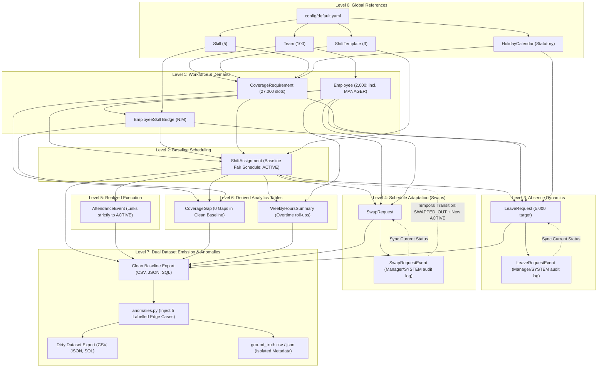

# Workforce Scheduling Synthetic Data Generator: System Design Document (DESIGN.md)

## 1. Executive Summary & Problem Statement

Workforce scheduling in operations-intensive domains (e.g., healthcare, logistics, customer support) requires balancing operational coverage demands, labor law compliance, and employee preferences. Schedulers must ensure:
1. **Minimum Coverage**: Ensuring sufficient headcount and critical skills are present for every shift.
2. **Labor Compliance**: Obeying statutory rest intervals (minimum 11 hours between shifts), weekly hour limits (40h standard, 48h hard overtime cap), and mandatory rest days (maximum 6 consecutive working days).
3. **Leave Processing**: Evaluating leave requests against coverage guarantees to prevent critical deficits.
4. **Schedule Adaptability**: Supporting peer-to-peer shift swaps with rigorous skill, rest, and manager checks.
5. **Operational Realities**: Simulating attendance variance (tardiness, early departures, overtime, no-shows) with end-to-end traceability.

This project delivers a **100% reproducible, zero-external-dependency synthetic data generator** written in Python 3.11+ using `pandas`, `numpy`, and `pyyaml`. The generated dataset mirrors real-world workforce management (WFM) enterprise schemas with append-only event sourcing for all lifecycle decisions.

### Target Scale Profiles
- **Default Production Profile**:
  - Seed: `20261022`
  - Scale: **2,000 employees**, **100 teams** (20 employees/team), **90 days** (2026-01-01 to 2026-03-31, Q1 2026), **5,000 leave requests**.
  - Total operational shift instances: $100 \times 90 \times 3 = 27,000$ shift slots.
  - Total scheduled assignments: ~108,000+ assignment rows.
- **Starter Profile (Fast Dev / CI Testing)**:
  - Scale: **50 employees**, **5 teams** (10 employees/team), **14 days** (2026-01-01 to 2026-01-14), **100 leave requests**.
  - Uses the **exact same code path** via CLI argument overrides:
    ```bash
    python run_generator.py \
      --seed 20261022 \
      --num-teams 5 \
      --employees-per-team 10 \
      --start-date 2026-01-01 \
      --end-date 2026-01-14 \
      --target-leave-requests 100 \
      --export-formats csv,json,sql \
      --output-dir output/starter
    ```

---

## 2. Core Assumptions & System Invariants

1. **Closed-World Reproducibility**:
   - All randomness is governed by an explicit seed (`seed: 20261022`) passed through `numpy.random.Generator`.
   - The generation pipeline does not touch networks, external APIs, or system clocks. All dates are anchored to a defined planning horizon: **January 1, 2026 to March 31, 2026 (Q1 2026, 90 days)**.

2. **Shift Instance Global Uniqueness Across 100 Teams (`SHIFT-YYYY-MM-DD-TEAMxxx-X`)**:
   - The brief introduced the conceptual pattern `SHIFT-YYYY-MM-DD-X`, where `X` denotes the shift template code (`A`, `B`, `C`).
   - In an enterprise scenario with **100 operational teams** simultaneously running shifts, using only `SHIFT-2026-01-01-A` would lead to an unavoidable primary key collision among all 100 teams.
   - **Deliberate Architectural Extension**: We extend `X` to include the team identifier: `SHIFT-{YYYY-MM-DD}-TEAM{team_id:03d}-{template_code}` (e.g., `SHIFT-2026-01-01-TEAM001-A`).
   - This satisfies the brief's naming intention while guaranteeing mathematical uniqueness across all $100 \times 90 \times 3 = 27,000$ operational shift instances.

3. **Temporal Structure & Shifts**:
   - Standard 24/7 continuous operations partitioned into three discrete 8-hour shift windows:
     - **Shift A (Morning)**: `06:00:00` to `14:00:00` (8.0 hours)
     - **Shift B (Afternoon)**: `14:00:00` to `22:00:00` (8.0 hours)
     - **Shift C (Night / Overnight)**: `22:00:00` to `06:00:00` (8.0 hours; concludes calendar day $d+1$)
   - Each shift incorporates a standardized 30-minute unpaid meal break.

4. **Organizational Hierarchy, Managers & Exclusion from Coverage**:
   - Employees belong to a single primary operational team.
   - Roles include: `STAFF` (65%), `SENIOR` (20%), `LEAD` (10%), and `MANAGER` (5%).
   - **Exclusion from Scheduling**: Employees with `role == 'MANAGER'` are administrative team supervisors. They are **never scheduled for operational shifts and are strictly excluded from coverage counts**.
   - **Manager Approval Invariant**: Any human approval or rejection in `LeaveRequestEvent` or `SwapRequest` must specify `actor_type = 'EMPLOYEE'` and be enacted by an employee whose `role == 'MANAGER'` and whose `team_id` matches the requester's `team_id`.
   - **Automated Engine Decisions**: The system supports `actor_type = 'SYSTEM'` (with `actor_id = NULL`) when decisions are automatically evaluated by the scheduling and coverage engine.

5. **Operational Roles of `HolidayCalendar`**:
   - **Leave Hour Counting**: Statutory holidays (`is_statutory = TRUE`) occurring within an approved leave window do NOT consume an employee's annual leave balance (exempt from paid leave quota deductions).
   - **Coverage Target Adjustment**: On recognized statutory holidays, operational teams transition from standard weekday staffing matrices to reduced weekend/holiday coverage tiers.
   - **Overtime & Premium Rate Flag**: Active shifts worked on statutory holidays are tagged for statutory holiday premium compensation during payroll roll-up.
   - **Relational Linkages**: Evaluated by date against `CoverageRequirement`, `ShiftAssignment`, and `LeaveRequest` via **derived calendar date joins (`calendar_date == date`) rather than database foreign key constraints**.

6. **Event Sourcing & Projection Rule**:
   - State mutations on requests (Leave, Swap) are immutable and append-only.
   - Both `LeaveRequestEvent` and `SwapRequestEvent` declare `actor_type` (`EMPLOYEE` / `SYSTEM`) with `actor_id` nullable for `SYSTEM`.
   - **Projection Invariants**:
     $$\text{LeaveRequest.current\_status} == \text{Latest}(\text{LeaveRequestEvent.to\_status})$$
     $$\text{SwapRequest.current\_status} == \text{Latest}(\text{SwapRequestEvent.to\_status})$$
   - Master request tables serve as read-model projections reflecting the latest transition in the respective event log.

7. **Non-Destructive Swap History with Temporal Bounds (`effective_from` / `effective_to`)**:
   - When an approved shift swap is applied, **`ShiftAssignment.employee_id` is never overwritten in place, and old rows are never deleted or reassigned**.
   - Every `ShiftAssignment` record includes bitemporal validity timestamps (`effective_from`, `effective_to`):
     - Initial assignments are generated with `assignment_status = 'ACTIVE'`, `effective_from = schedule_published_at`, and `effective_to = NULL`.
     - When a swap is applied, the original assignment rows are updated **strictly in two fields**: `assignment_status` $\leftarrow$ `'SWAPPED_OUT'` and `effective_to` $\leftarrow \text{applied\_at}$.
     - New replacement rows are inserted for the exchanged employees with `assignment_status = 'ACTIVE'`, `effective_from = swap_applied_at`, `effective_to = NULL`, linking to `swap_request_id` and `replaces_assignment_id`.
   - This provides complete audit lineage, immutable history, and effortless point-in-time reconstruction.

---

## 3. Capacity Feasibility & Mathematical Coverage Proof

A critical requirement of synthetic workforce generation is ensuring that baseline demand is **provably feasible** given workforce constraints, eliminating artificial schedule infeasibility.

### 3.1 Mathematical Capacity Model
For each operational team of 20 employees over a 7-day calendar week:
1. **Team Composition & Schedulable Staff**:
   - Each team consists of 20 employees: 1 Manager (5%) and 19 schedulable staff members (`STAFF`, `SENIOR`, `LEAD`).
   - Managers are not scheduled for operational shifts and are excluded from coverage headcounts.
   - Schedulable Staff: $N_{\text{sched}} = 19\text{ employees/team}$.

2. **FTE Distribution**:
   - 85% Full-time (1.0 FTE = 40.0 h/week = 5 shifts/week)
   - 10% Part-time (0.8 FTE = 32.0 h/week = 4 shifts/week)
   - 5% Half-time (0.5 FTE = 20.0 h/week = 2.5 shifts/week)
   - **Average FTE**:
     $$\overline{\text{FTE}} = 0.85(1.0) + 0.10(0.8) + 0.05(0.5) = 0.85 + 0.08 + 0.025 = 0.955$$
   - Average contractual hours per employee: $0.955 \times 40.0 = 38.2\text{ hours/week}$.
   - Average shift capacity per employee: $\frac{38.2}{8.0} = 4.775\text{ shifts/week}$.

3. **Total Weekly Team Supply**:
   $$\text{Supply}_{\text{team}} = 19\text{ schedulable staff} \times 4.775\text{ shifts/emp} = 90.725\text{ shifts/week} \quad (725.8\text{ hours/week})$$

4. **Total Weekly Team Demand (Coverage Requirements)**:
   - **Weekdays (Mon–Fri, 5 days)**:
     - Shift A (Morning): 3 staff
     - Shift B (Afternoon): 3 staff
     - Shift C (Night): 2 staff
     - Daily weekday demand: $3 + 3 + 2 = 8\text{ shifts/day}$.
     - 5 weekdays: $8 \times 5 = 40\text{ shifts}$.
   - **Weekends (Sat–Sun, 2 days)**:
     - Shift A (Morning): 2 staff
     - Shift B (Afternoon): 2 staff
     - Shift C (Night): 1 staff
     - Daily weekend demand: $2 + 2 + 1 = 5\text{ shifts/day}$.
     - 2 weekend days: $5 \times 2 = 10\text{ shifts}$.
   - **Total Weekly Demand per Team**:
     $$\text{Demand}_{\text{team}} = 40 + 10 = 50\text{ shifts/week} \quad (400.0\text{ hours/week})$$

5. **Capacity Feasibility & Reserve Buffer**:
   $$\text{Utilization Rate} = \frac{\text{Demand}_{\text{team}}}{\text{Supply}_{\text{team}}} = \frac{50}{90.725} \approx 55.11\%$$
   $$\text{Reserve Margin} = 100\% - 55.11\% = 44.89\% \quad (\approx 40.7\text{ excess shifts/week})$$

5. **Leave & Absence Tolerance**:
   - Target 5,000 leave requests across 2,000 employees over 90 days ($\approx 12.86$ weeks) equates to $\approx 3.9$ leave requests per team per week.
   - With an average leave duration of 2 to 3 days, an average of $1.1$ employees per team are on leave at any given time.
   - Available active workforce during leave: $\approx 18.9$ employees, providing $\approx 90.2$ available shifts/week, which vastly exceeds the required $50$ shifts/week.
   - Rest period constraints (11h rest) and maximum 6-consecutive-day limits are easily accommodated because employees only need to work an average of $2.5$ shifts per week to cover demand ($50 / 20 = 2.5$).

### 3.2 Expected Coverage Gaps in Clean Baseline
> [!IMPORTANT]
> **Expected Number of Coverage Gaps in Clean Baseline**: **EXACTLY ZERO (0)**.
> Because the capacity ratio is $> 1.9\times$ demand and skill distribution ensures all teams have sufficient `TRIAGE` and `DISPATCH` certified staff, the greedy scheduler produces **0 coverage gaps** across all 27,000 shift slots. In the derived `CoverageGap` table, `is_critical` will be `FALSE` for 100% of rows in the clean baseline.

---

## 4. Business Rules & Constraints

All parameters and thresholds are externalized in [`config/default.yaml`](file:///e:/workforce-schedule-synthetic-data/config/default.yaml).

### 4.1 Labor Law & Fatigue Constraints
1. **Rest Interval**: Minimum **11 hours** of continuous rest between the conclusion of shift $S_i$ and commencement of shift $S_{i+1}$.
2. **Consecutive Days**: An employee may work a maximum of **6 consecutive days**. On or before the 7th day, at least one full 24-hour calendar rest day is mandatory.
3. **Weekly Hours & Overtime**:
   - Standard work week: 40.0 hours (pro-rated by FTE).
   - Hard statutory overtime cap: **48.0 hours** in any ISO calendar week (Monday through Sunday).
   - No shift assignment or swap approval may cause an employee's weekly scheduled hours to exceed 48.0.

### 4.2 Coverage Requirements
- For every date, team, shift template, and skill:
  $$\text{ScheduledActiveHeadcount}(d, T, S, K) \ge \text{CoverageRequirement.min\_headcount}(d, T, S, K)$$

### 4.3 Leave Request Approval Policy
1. An employee submits a leave request for $[d_{\text{start}}, d_{\text{end}}]$.
2. The engine computes counterfactual staffing across the employee's assigned shifts:
   $$\text{AvailableHeadcount}(d, T, S, K) = \text{CurrentActiveHeadcount}(d, T, S, K) - 1$$
3. **Decision Rule**:
   - If $\text{AvailableHeadcount}(d, T, S, K) \ge \text{min\_headcount}(d, T, S, K)$ for all affected dates and skills:
     $\rightarrow$ Status transitions to `APPROVED`.
   - Else:
     $\rightarrow$ Status transitions to `REJECTED` with an explicit reason logged in `LeaveRequestEvent`.
4. Approver must be a Manager of the requester's team (`role == 'MANAGER'`, `team_id == requester.team_id`) or `'SYSTEM'`.

### 4.4 Shift Swap Policy & Non-Destructive Mechanics
1. Two employees $E_1$ (assigned to $A_1$) and $E_2$ (assigned to $A_2$) agree on a trade.
2. A `SwapRequest` is created in state `REQUESTED`.
3. **Validation Gates**:
   - **Same Team Invariant**: $E_1$ and $E_2$ must belong to the **same operational team** ($E_1.\text{team\_id} == E_2.\text{team\_id}$).
   - **Skill Match**: $E_2$ possesses certified active skills required by $A_1$; $E_1$ possesses certified active skills required by $A_2$.
   - **Rest Period**: Neither employee incurs an 11-hour rest violation post-swap.
   - **Weekly Cap**: Swapping does not push either employee above 48.0 weekly hours.
4. **Approval & Application**:
   - Approver must be a Manager of the requester's team (`manager_employee_id.role == 'MANAGER'`, `team_id == requester.team_id`) or `'SYSTEM'`.
   - Upon `APPLIED`:
     - $A_1$ and $A_2$ have `assignment_status` updated to `'SWAPPED_OUT'` and `effective_to` closed to `applied_at`.
     - Old rows are **never deleted or reassigned**; their `employee_id` remains unchanged.
     - New replacement rows $A_{\text{new1}}$ (assigned to $E_2$) and $A_{\text{new2}}$ (assigned to $E_1$) are inserted with `assignment_status = 'ACTIVE'`, `effective_from = applied_at`, `effective_to = NULL`, linking to `swap_request_id` and `replaces_assignment_id`.

### 4.5 Attendance & Punch Simulation
- **Active Assignment Linkage**: Attendance punches link **strictly and exclusively to `ACTIVE` `ShiftAssignment` records**. Superseded `SWAPPED_OUT` records never have punch activity.
- **Exception Types**:
  - `LATE`: Clock-in $> 10$ minutes after scheduled start.
  - `EARLY_LEAVE`: Clock-out $> 15$ minutes before scheduled end.
  - `NO_SHOW`: Scheduled active employee fails to clock in (unexcused absence).
  - `OVERTIME`: Clock-out extension $> 15$ minutes past scheduled end.

---

## 5. Generation Pipeline & Dependency Order



### Topological Execution Steps:
1. **Step 1: Configuration & Static Dimensions (Level 0)**: Parse config (`seed: 20261022`), generate `ShiftTemplate`, `HolidayCalendar`, `Skill`, `Team` (100 teams).
2. **Step 2: Workforce Roster & Skills Generation (Level 1)**: Generate 2,000 employees with roles (`STAFF`, `SENIOR`, `LEAD`, `MANAGER`) and FTE contracts; assign skills via `EmployeeSkill`; generate 27,000 `CoverageRequirement` slots.
3. **Step 3: Baseline Schedule Synthesis (Level 2)**: Synthesize fair, conflict-free baseline schedule with 11h rest, 6-day limits, and 40h/48h caps. Emit initial `ShiftAssignment` records in `ACTIVE` status with `effective_from = horizon_start`, `effective_to = NULL`.
4. **Step 4: Leave Simulation & Coverage Evaluation (Level 3)**: Process 5,000 leave requests against counterfactual coverage. Approvals logged by team managers or `'SYSTEM'`. Sync `current_status`.
5. **Step 5: Swap Simulation & Temporal History (Level 4)**: Process peer swaps. For applied swaps, close `effective_to` on original rows, set to `SWAPPED_OUT`, and insert new replacement rows with `assignment_status = 'ACTIVE'` and `effective_from = applied_at`.
6. **Step 6: Attendance Punches & Exceptions (Level 5)**: Link timeclock punches **strictly to active assignments**. Flag `LATE`, `EARLY_LEAVE`, `NO_SHOW`, and `OVERTIME`.
7. **Step 7: Derived Analytics Aggregation (Level 6)**: Compute derived `CoverageGap` (asserting 0 gaps) and `WeeklyHoursSummary` (auditing 48.0h caps).
8. **Step 8: Dual Dataset Emission & Anomaly Injection (Level 7)**: Export clean baseline dataset; run `anomalies.py` to produce dirty dataset and `ground_truth.csv`/`json`; run `report.py` for distribution analysis.

---

## 6. Derived Analytics Tables Specification

Derived tables provide high-performance query projections computed directly from source operational records.

### 6.1 `CoverageGap`
- **Purpose**: Tracks operational staffing compliance by comparing required headcount against active scheduled headcount per team, date, shift, and skill.
- **Relational Invariant**: Contains a direct foreign key `coverage_id` pointing to `CoverageRequirement(coverage_id)`. Does **not** maintain FK constraints from mutable `ShiftAssignment`.
- **Derivation**:
  $$\text{scheduled\_headcount} = \sum_{e \in \text{ActiveAssigned}(d, T, S)} \mathbb{I}(e \text{ holds skill } K)$$
  $$\text{gap\_headcount} = \max(0, \; \text{required\_headcount} - \text{scheduled\_headcount})$$
  $$\text{is\_critical} = (\text{gap\_headcount} > 0)$$
- **Expected Baseline Result**: Exactly **0 critical gaps** (`is_critical = FALSE` across all 27,000 records).

### 6.2 `WeeklyHoursSummary`
- **Purpose**: Audits weekly workload, regular hours, overtime hours, and compliance with the 48.0-hour statutory ceiling.
- **Overnight Shifts & Partial Weeks**:
  - Overnight shifts (Shift C: 22:00 to 06:00 $d+1$) count **strictly toward the ISO week of their start date (`shift_date`)**.
  - `is_partial_week`: Truncated horizon boundary weeks (W01 and W14) have `is_partial_week = TRUE`. Complete weeks (W02 through W13) have `is_partial_week = FALSE`.
  - The 48.0-hour statutory overtime cap **applies strictly to full weeks only (`is_partial_week == FALSE`)**.
- **Derivation**:
  - Aggregates active `ShiftAssignment` records per employee per ISO week.
  - $\text{regular\_hours} = \min(\text{scheduled\_hours}, \text{contract\_hours})$
  - $\text{overtime\_hours} = \max(0, \text{scheduled\_hours} - \text{contract\_hours})$
  - $\text{exceeds\_overtime\_cap} = (\text{scheduled\_hours} > 48.0 \land \neg \text{is\_partial\_week})$

---

## 7. Anomaly Injection Engine (`anomalies.py`)

The anomaly injection engine (`src/workforce_generator/anomalies.py`) synthesizes realistic data defects into a copy of the clean dataset.

### The 5 Injected Edge Cases:
1. **`DOUBLE_BOOKED_EMPLOYEE`**: Schedules an employee on two overlapping active shifts on the same date.
2. **`APPROVED_LEAVE_OVERLAPPING_SHIFT`**: Retains an active shift assignment during an approved leave date.
3. **`REQUIRED_SKILL_ABSENT`**: Removes or mutates certified staff such that an active shift slot lacks a mandatory skill.
4. **`OVERTIME_CAP_EXCEEDED`**: Assigns shift hours exceeding 48.0 hours in an ISO calendar week.
5. **`SWAP_APPLIED_WITHOUT_APPROVAL`**: Sets a swap to `APPLIED` without required manager approval or while `REJECTED`.

### Ground Truth Schema (`ground_truth.csv` / `ground_truth.json`)
The ground truth file logs every injected anomaly with absolute precision:
```csv
anomaly_id,anomaly_type,table_name,record_id,field_name,expected_value,actual_value,description,injected_at
ANM-0001,DOUBLE_BOOKED_EMPLOYEE,ShiftAssignment,ASN-2026-004521,employee_id,EMP-000342,EMP-000105,"Employee EMP-000105 assigned to two overlapping shifts on 2026-01-15",2026-10-30T10:00:00Z
ANM-0002,APPROVED_LEAVE_OVERLAPPING_SHIFT,ShiftAssignment,ASN-2026-008920,assignment_status,SWAPPED_OUT,ACTIVE,"Active shift assignment overlaps with approved leave LVE-2026-000214",2026-10-30T10:00:00Z
ANM-0003,REQUIRED_SKILL_ABSENT,ShiftAssignment,ASN-2026-012450,employee_id,EMP-000812,EMP-000004,"Shift SHIFT-2026-02-01-TEAM012-A lacks required TRIAGE skill",2026-10-30T10:00:00Z
ANM-0004,OVERTIME_CAP_EXCEEDED,ShiftAssignment,ASN-2026-018230,duration_hours,8.0,16.0,"Employee EMP-000450 scheduled for 56.0 hours in week 2026-W06",2026-10-30T10:00:00Z
ANM-0005,SWAP_APPLIED_WITHOUT_APPROVAL,SwapRequest,SWP-2026-000088,current_status,REJECTED,APPLIED,"Swap marked APPLIED without manager approval event",2026-10-30T10:00:00Z
```

> [!IMPORTANT]
> **Ground Truth Isolation Guarantee**:
> `ground_truth.csv` and `ground_truth.json` are written to disk as external audit references. They are **strictly prohibited** from being imported, read, or utilized as features by `validate.py` or any downstream machine learning model.

---

## 8. Independent Validator (`validate.py`)

`validate.py` is an autonomous, rule-based audit script that executes against any generated dataset without access to `ground_truth.*`. It verifies ten fundamental categories of structural, relational, and business constraints:
1. **Primary Key Uniqueness**: Confirms 0 duplicate PKs across all 15 tables (including derived tables).
2. **Foreign Key Integrity**: Confirms all child FKs resolve to valid parent rows.
3. **Enum & Domain Validation**: Confirms roles (including `MANAGER`), statuses (`ACTIVE`, `SWAPPED_OUT`), exception types (`NO_SHOW`, `LATE`, `EARLY_LEAVE`, `OVERTIME`), etc.
4. **Date & Timestamp Chronology**: Confirms date orderings, punch intervals, and temporal bounds (`effective_from <= effective_to`).
5. **Arithmetic Reconciliation**: Validates contract hours, punch variances, and derived table roll-ups.
6. **Lifecycle State & Manager Authorization**:
   - Asserts `LeaveRequest.current_status == latest LeaveRequestEvent.to_status`.
   - Asserts `SwapRequest.current_status == latest SwapRequestEvent.to_status`.
   - Asserts non-system approvers have `role == 'MANAGER'` and match the requester's team.
7. **Duplicate Prevention**: No employee has duplicate active assignments on the same shift date.
8. **Working-Hour & Fatigue Limits**:
   - Confirms $\le 48.0$ active hours per ISO week.
   - Confirms $\ge 11.0$ hours rest between consecutive active shifts.
   - Confirms $\le 6$ consecutive working days.
9. **Coverage Satisfaction**: Asserts active assignments satisfy coverage demand and verifies derived `CoverageGap` has 0 critical gaps in clean baseline.
10. **Attendance vs. Active Schedule Alignment**: Confirms punches link exclusively to active assignments, exception types match rules, and no punches exist during approved leaves.

---

## 9. Data Exports: CSV, JSON, and SQL Seed Data

Data export (`src/workforce_generator/export.py`) serializes both the clean baseline and dirty datasets into three standard storage formats:
1. **CSV (Comma-Separated Values)**: RFC 4180 compliant CSV files with headers for data warehouses.
2. **JSON (JavaScript Object Notation)**: Structured JSON array format (one `.json` file per entity).
3. **ANSI SQL Seed Data (`.sql`)**:
   - Complete DDL (`CREATE TABLE` statements with primary keys, foreign keys, and column constraints).
   - Batched `INSERT INTO` statements (chunked in blocks of 500 rows) ready for instant execution into PostgreSQL, MySQL, SQLite, or Snowflake.
- **Explicit Exclusion**: Parquet is deliberately excluded per architectural guidelines to eliminate external binary dependencies and ensure universal accessibility.

---

## 10. Reproducibility & Distribution Reporting

### 10.1 Reproducibility Verification Script (`scripts/check_reproducibility.sh`)
An automated shell script ensuring 100% deterministic reproducibility:
1. Generates the clean dataset into `/tmp/run_1` using seed `20261022`.
2. Generates the clean dataset into `/tmp/run_2` using seed `20261022`.
3. Computes SHA-256 checksums across all generated CSV, JSON, and SQL files.
4. Performs a bitwise `diff -r /tmp/run_1 /tmp/run_2`.
5. Fails immediately if any file checksum mismatches.

### 10.2 Distribution Report (`src/workforce_generator/report.py`)
A distribution reporting utility evaluates the statistical properties of the generated dataset:
- Headcount distribution across teams and roles (verifying 65% Staff, 20% Senior, 10% Lead, 5% Manager).
- FTE contract ratios (verifying 85% 1.0 FTE, 10% 0.8 FTE, 5% 0.5 FTE).
- Leave request volume and approval rates by leave type.
- Swap request volume and approval/rejection rates.
- Attendance punch variance distributions (mean, median, standard deviation, exception frequency).
- Generates a human-readable Markdown/terminal summary report.

---

## 11. Repository Structure & Module Architecture

```
workforce-schedule-synthetic-data/
├── config/
│   └── default.yaml                 # Master configuration (seed 20261022, 2000 emp, 100 teams, 90 days, 5000 leaves)
├── docs/
│   ├── data_dictionary.md           # Field specifications, types, constraints, ground truth schema, derived tables
│   └── er_diagram.md                # Mermaid ER diagram, relationship cardinality, lifecycle state machines
├── scripts/
│   └── check_reproducibility.sh     # Shell script to assert bit-for-bit identical outputs across runs
├── src/
│   └── workforce_generator/
│       ├── __init__.py              # Package entry point
│       ├── config.py                # Config loader & CLI override merger
│       ├── models/
│       │   ├── __init__.py
│       │   ├── entities.py          # Strongly-typed dataclasses for all core entities, events, and derived tables
│       │   └── identifiers.py       # ID formatting helpers (SHIFT-YYYY-MM-DD-TEAMXXX-A, etc.)
│       ├── generators/
│       │   ├── __init__.py
│       │   ├── organization.py      # Teams (100), Skills, Employees (2,000; incl MANAGER), EmployeeSkill bridge
│       │   ├── coverage.py          # Daily CoverageRequirement demand matrix (27,000 slots)
│       │   ├── scheduler.py         # Baseline schedule synthesizer (11h rest, 6-day max, 48h cap, temporal fields)
│       │   ├── leave.py             # Generates LeaveRequests and LeaveRequestEvents (evaluates coverage & manager rules)
│       │   ├── swap.py              # Generates SwapRequests, checks eligibility, non-destructive row insertion
│       │   ├── attendance.py        # Simulates AttendanceEvents (links only to ACTIVE), clock in/out variance, exceptions
│       │   └── analytics.py         # Computes derived tables: CoverageGap (0 gaps) and WeeklyHoursSummary
│       ├── anomalies.py             # Injects the 5 labelled edge cases into a dirty dataset copy
│       ├── pipeline.py              # Top-level orchestrator executing steps in topological order
│       ├── export.py                # Exports DataFrames to CSV, JSON, and ANSI SQL seed files
│       └── report.py                # Computes distribution report and summary statistics
├── tests/
│   ├── __init__.py
│   ├── test_config.py               # Tests config loading and parameter overrides
│   ├── test_identifiers.py          # Verifies ID formatting and cross-team shift uniqueness
│   ├── test_organization.py         # Tests employee and skill distributions, manager roles
│   ├── test_scheduler.py            # Tests 11h rest, 6-day max, and 48h overtime constraint compliance
│   ├── test_leave_approval.py       # Tests leave approval, coverage checks, and manager team matching
│   ├── test_swap_validation.py      # Tests non-destructive swap insertion and temporal history preservation
│   ├── test_attendance.py           # Tests attendance variance distributions and exception flagging (ACTIVE only)
│   ├── test_anomalies.py            # Tests injection of all 5 synthetic anomalies
│   └── test_pipeline_reproducibility.py # Tests deterministic output matching given the same random seed
├── run_generator.py                 # CLI executable script to run generation and export datasets
├── validate.py                      # Independent audit script verifying constraints and integrity
├── DESIGN.md                        # Architectural design, assumptions, and validation rules
└── README.md                        # Quickstart, setup instructions, and evaluation metrics
```

### Module Breakdown & Responsibilities:

| Module Path | Primary Responsibility | Key Inputs | Key Outputs |
| :--- | :--- | :--- | :--- |
| `src/workforce_generator/config.py` | Load YAML configuration and apply CLI argument overrides. | `config/default.yaml`, CLI flags | `GeneratorConfig` dataclass |
| `src/workforce_generator/models/` | Type-annotated dataclasses and immutable ID formatters. | Raw values | Strongly typed entity records |
| `src/workforce_generator/generators/organization.py` | Build organizational structure: teams (100), skills, employees (2,000; incl MANAGER), and certifications. | `GeneratorConfig`, `np.random.Generator` | `List[Team]`, `List[Skill]`, `List[Employee]`, `List[EmployeeSkill]` |
| `src/workforce_generator/generators/coverage.py` | Generate daily staffing demand matrices across horizon (27,000 shift slots). | Horizon dates, shift templates, teams, skills | `List[CoverageRequirement]` |
| `src/workforce_generator/generators/scheduler.py` | Assign employees to shift slots while enforcing rest, 6-day, and 48h rules. | Employees, skills, coverage requirements | `List[ShiftAssignment]` |
| `src/workforce_generator/generators/leave.py` | Sample 5,000 leave requests, evaluate counterfactual coverage, log manager/SYSTEM audit events. | Assignments, coverage requirements, employees | `List[LeaveRequest]`, `List[LeaveRequestEvent]` |
| `src/workforce_generator/generators/swap.py` | Generate shift trades, verify skills & rest invariants, insert replacement active rows with temporal bounds. | Assignments, employee skills, employees | `List[SwapRequest]`, `List[SwapRequestEvent]`, updated `ShiftAssignment` |
| `src/workforce_generator/generators/attendance.py` | Sample real-time clock-in/out timestamps linking strictly to active assignments, flag exceptions. | Finalized active assignments, variance configs | `List[AttendanceEvent]` |
| `src/workforce_generator/generators/analytics.py` | Compute derived `CoverageGap` (asserting 0 gaps) and `WeeklyHoursSummary` roll-up tables. | `CoverageRequirement`, `ShiftAssignment`, `Employee` | `List[CoverageGap]`, `List[WeeklyHoursSummary]` |
| `src/workforce_generator/anomalies.py` | Inject the 5 labelled edge cases into a dirty copy of the dataset; emit ground truth. | Clean DataFrames | Dirty DataFrames, `ground_truth.csv`, `ground_truth.json` |
| `src/workforce_generator/pipeline.py` | Orchestrate end-to-end execution flow in topological sequence. | `GeneratorConfig` | Clean & Dirty DataFrames, Ground Truth |
| `src/workforce_generator/export.py` | Serialize DataFrames to CSV, JSON, and ANSI SQL seed files. | DataFrames, output directory | Files on disk |
| `src/workforce_generator/report.py` | Generate distribution metrics and summary statistics. | DataFrames | Distribution Report (Markdown / text) |
| `validate.py` | Standalone validator checking 10 constraint categories without ground truth. | Dataset directory (clean or dirty) | Exit code 0/1, Violation Report |

---

## 12. Validation & Acceptance Criteria

The system guarantees mathematical correctness, relational integrity, and diagnostic precision through rigorous acceptance criteria:

1. **Clean Baseline Dataset Acceptance**:
   - When `validate.py` executes against the clean baseline dataset:
     ```bash
     python validate.py --data-dir output/clean
     ```
   - **Result**: The validator reports **exactly zero (0) violations** across all 10 integrity categories and exits with code `0`.
   - All PK/FK checks pass, all working hours adhere to statutory caps ($\le 48.0$ hours/week, $\ge 11.0$ hours rest, $\le 6$ consecutive days), all coverage requirements are satisfied, derived `CoverageGap` has 0 critical gaps, and all `current_status` values match the latest event logs.

2. **Dirty Dataset Acceptance & Anomaly Reconciliation**:
   - When `validate.py` executes against the dirty dataset:
     ```bash
     python validate.py --data-dir output/dirty
     ```
   - **Result**: The validator reports **strictly and exactly the injected anomalies** and exits with code `1`.
   - The detected violation set from `validate.py` must reconcile 1:1 with `ground_truth.csv` / `ground_truth.json`:
     $$\text{DetectedViolations}(\text{DirtyDataset}) \equiv \text{GroundTruthInjections}$$
   - No uninjected spurious violations (0 false positives).
   - No injected anomalies missed (0 false negatives).

3. **Reproducibility Acceptance**:
   - Executing `scripts/check_reproducibility.sh` generates identical datasets across independent runs:
     ```bash
     bash scripts/check_reproducibility.sh
     ```
   - All SHA-256 hashes must match bit-for-bit with `0` diffs.
