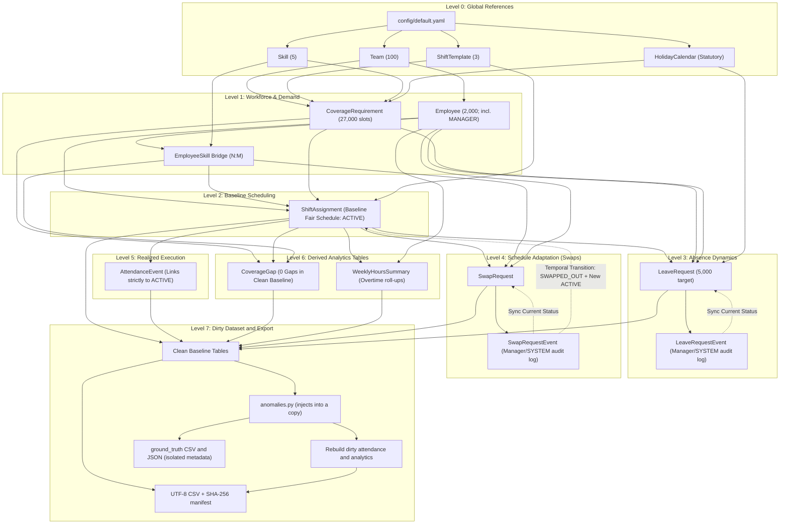

# Workforce Scheduling Synthetic Data Generator: System Design Document (DESIGN.md)

## 1. Executive Summary & Problem Statement

Workforce scheduling in operations-intensive domains (e.g., healthcare, logistics, customer support) requires balancing operational coverage demands, labor law compliance, and employee preferences. Schedulers must ensure:
1. **Minimum Coverage**: Ensuring sufficient headcount and critical skills are present for every shift.
2. **Labor Compliance**: Obeying statutory rest intervals (minimum 11 hours between shifts), weekly hour limits (40h standard, 48h hard overtime cap), and mandatory rest days (maximum 6 consecutive working days).
3. **Leave Processing**: Evaluating leave requests against coverage guarantees to prevent critical deficits.
4. **Schedule Adaptability**: Supporting peer-to-peer shift swaps with rigorous skill, rest, and manager checks.
5. **Operational Realities**: Simulating attendance variance (tardiness, early departures, overtime, no-shows) with end-to-end traceability.

This project delivers a **100% reproducible, zero-external-dependency synthetic data generator** written in Python 3.11+ using `pandas`, `numpy`, and `pyyaml`. The generated dataset mirrors real-world workforce management (WFM) enterprise schemas with append-only event sourcing for all lifecycle decisions.

### Target Scale Profiles
- **Default Production Profile**:
  - Seed: `20261022`
  - Scale: **2,000 employees**, **100 teams** (20 employees/team), **90 days** (2026-01-01 to 2026-03-31, Q1 2026), **5,000 leave requests**.
  - Total operational shift instances: $100 \times 90 \times 3 = 27,000$ shift slots.
  - Total scheduled assignments: ~108,000+ assignment rows.
- **Starter Profile (Fast Dev / CI Testing)**:
  - Scale: **50 employees**, **5 teams** (10 employees/team), **14 days** (2026-01-01 to 2026-01-14), **100 leave requests**.
  - Uses the **exact same generation, anomaly, and export code path**:
    ```bash
    python run_generator.py --profile starter --out output
    ```
- **Full Profile**: `python run_generator.py --profile full --out output`.
- Default anomalies are **3 of each type** for starter and **15 of each type** for full. Use `--anomalies-per-type N` to override the count.

---

## 2. Core Assumptions & System Invariants

1. **Closed-World Reproducibility**:
   - All randomness is governed by an explicit seed (`seed: 20261022`) passed through `numpy.random.Generator`.
   - The generation pipeline does not touch networks, external APIs, or system clocks. All dates are anchored to a defined planning horizon: **January 1, 2026 to March 31, 2026 (Q1 2026, 90 days)**.

2. **Shift Instance Global Uniqueness Across 100 Teams (`SHIFT-YYYY-MM-DD-TEAMxxx-X`)**:
   - The brief introduced the conceptual pattern `SHIFT-YYYY-MM-DD-X`, where `X` denotes the shift template code (`A`, `B`, `C`).
   - In an enterprise scenario with **100 operational teams** simultaneously running shifts, using only `SHIFT-2026-01-01-A` would lead to an unavoidable primary key collision among all 100 teams.
   - **Deliberate Architectural Extension**: We extend `X` to include the team identifier: `SHIFT-{YYYY-MM-DD}-TEAM{team_id:03d}-{template_code}` (e.g., `SHIFT-2026-01-01-TEAM001-A`).
   - This satisfies the brief's naming intention while guaranteeing mathematical uniqueness across all $100 \times 90 \times 3 = 27,000$ operational shift instances.

3. **Temporal Structure & Shifts**:
   - Standard 24/7 continuous operations partitioned into three discrete 8-hour shift windows:
     - **Shift A (Morning)**: `06:00:00` to `14:00:00` (8.0 hours)
     - **Shift B (Afternoon)**: `14:00:00` to `22:00:00` (8.0 hours)
     - **Shift C (Night / Overnight)**: `22:00:00` to `06:00:00` (8.0 hours; concludes calendar day $d+1$)
   - Each shift incorporates a standardized 30-minute unpaid meal break.

4. **Organizational Hierarchy, Managers & Exclusion from Coverage**:
   - Employees belong to a single primary operational team.
   - Roles include: `STAFF` (65%), `SENIOR` (20%), `LEAD` (10%), and `MANAGER` (5%).
   - **Exclusion from Scheduling**: Employees with `role == 'MANAGER'` are administrative team supervisors. They are **never scheduled for operational shifts and are strictly excluded from coverage counts**.
   - **Manager Approval Invariant**: Any human approval or rejection in `LeaveRequestEvent` or `SwapRequestEvent` must specify `actor_type = 'EMPLOYEE'` and be enacted by an employee whose `role == 'MANAGER'` and whose `team_id` matches the requester's `team_id`; for swaps, the actor cannot be either participant. SYSTEM decisions use `actor_type = 'SYSTEM'` and `actor_id = NULL`.
   - **Automated Engine Decisions**: The system supports `actor_type = 'SYSTEM'` (with `actor_id = NULL`) when decisions are automatically evaluated by the scheduling and coverage engine.

5. **Operational Roles of `HolidayCalendar`**:
   - **Leave Hour Counting**: Statutory holidays (`is_statutory = TRUE`) occurring within an approved leave window do NOT consume an employee's annual leave balance (exempt from paid leave quota deductions).
   - **Coverage Target Adjustment**: On recognized statutory holidays, operational teams transition from standard weekday staffing matrices to reduced weekend/holiday coverage tiers.
   - **Overtime & Premium Rate Flag**: Active shifts worked on statutory holidays are tagged for statutory holiday premium compensation during payroll roll-up.
   - **Relational Linkages**: Evaluated by date against `CoverageRequirement`, `ShiftAssignment`, and `LeaveRequest` via **derived calendar date joins (`calendar_date == date`) rather than database foreign key constraints**.

6. **Event Sourcing & Projection Rule**:
   - State mutations on requests (Leave, Swap) are immutable and append-only.
   - Both `LeaveRequestEvent` and `SwapRequestEvent` declare `actor_type` (`EMPLOYEE` / `SYSTEM`) with `actor_id` nullable for `SYSTEM`.
   - **Projection Invariants**:
     $$\text{LeaveRequest.current\_status} == \text{Latest}(\text{LeaveRequestEvent.to\_status})$$
     $$\text{SwapRequest.current\_status} == \text{Latest}(\text{SwapRequestEvent.to\_status})$$
   - Master request tables serve as read-model projections reflecting the latest transition in the respective event log.

7. **Non-Destructive Swap History with Temporal Bounds (`effective_from` / `effective_to`)**:
   - When an approved shift swap is applied, **`ShiftAssignment.employee_id` is never overwritten in place, and old rows are never deleted or reassigned**.
   - Every `ShiftAssignment` record includes bitemporal validity timestamps (`effective_from`, `effective_to`):
     - Initial assignments are generated with `assignment_status = 'ACTIVE'`, `effective_from = schedule_published_at`, and `effective_to = NULL`.
     - When a swap is applied, the original assignment rows are updated **strictly in two fields**: `assignment_status` $\leftarrow$ `'SWAPPED_OUT'` and `effective_to` $\leftarrow \text{applied\_at}$.
     - New replacement rows are inserted for the exchanged employees with `assignment_status = 'ACTIVE'`, `effective_from = swap_applied_at`, `effective_to = NULL`, linking to `swap_request_id` and `replaces_assignment_id`.
   - This provides complete audit lineage, immutable history, and effortless point-in-time reconstruction.

---

## 3. Capacity Feasibility & Mathematical Coverage Proof

A critical requirement of synthetic workforce generation is ensuring that baseline demand is **provably feasible** given workforce constraints, eliminating artificial schedule infeasibility.

### 3.1 Mathematical Capacity Model
For each operational team of 20 employees over a 7-day calendar week:
1. **Team Composition & Schedulable Staff**:
   - Each team consists of 20 employees: 1 Manager (5%) and 19 schedulable staff members (`STAFF`, `SENIOR`, `LEAD`).
   - Managers are not scheduled for operational shifts and are excluded from coverage headcounts.
   - Schedulable Staff: $N_{\text{sched}} = 19\text{ employees/team}$.

2. **FTE Distribution**:
   - 85% Full-time (1.0 FTE = 40.0 h/week = 5 shifts/week)
   - 10% Part-time (0.8 FTE = 32.0 h/week = 4 shifts/week)
   - 5% Half-time (0.5 FTE = 20.0 h/week = 2.5 shifts/week)
   - **Average FTE**:
     $$\overline{\text{FTE}} = 0.85(1.0) + 0.10(0.8) + 0.05(0.5) = 0.85 + 0.08 + 0.025 = 0.955$$
   - Average contractual hours per employee: $0.955 \times 40.0 = 38.2\text{ hours/week}$.
   - Average shift capacity per employee: $\frac{38.2}{8.0} = 4.775\text{ shifts/week}$.

3. **Total Weekly Team Supply**:
   $$\text{Supply}_{\text{team}} = 19\text{ schedulable staff} \times 4.775\text{ shifts/emp} = 90.725\text{ shifts/week} \quad (725.8\text{ hours/week})$$

4. **Total Weekly Team Demand (Coverage Requirements)**:
   - **Weekdays (Mon–Fri, 5 days)**:
     - Shift A (Morning): 3 staff
     - Shift B (Afternoon): 3 staff
     - Shift C (Night): 2 staff
     - Daily weekday demand: $3 + 3 + 2 = 8\text{ shifts/day}$.
     - 5 weekdays: $8 \times 5 = 40\text{ shifts}$.
   - **Weekends (Sat–Sun, 2 days)**:
     - Shift A (Morning): 2 staff
     - Shift B (Afternoon): 2 staff
     - Shift C (Night): 1 staff
     - Daily weekend demand: $2 + 2 + 1 = 5\text{ shifts/day}$.
     - 2 weekend days: $5 \times 2 = 10\text{ shifts}$.
   - **Total Weekly Demand per Team**:
     $$\text{Demand}_{\text{team}} = 40 + 10 = 50\text{ shifts/week} \quad (400.0\text{ hours/week})$$

5. **Capacity Feasibility & Reserve Buffer**:
   $$\text{Utilization Rate} = \frac{\text{Demand}_{\text{team}}}{\text{Supply}_{\text{team}}} = \frac{50}{90.725} \approx 55.11\%$$
   $$\text{Reserve Margin} = 100\% - 55.11\% = 44.89\% \quad (\approx 40.7\text{ excess shifts/week})$$

5. **Leave & Absence Tolerance**:
   - Target 5,000 leave requests across 2,000 employees over 90 days ($\approx 12.86$ weeks) equates to $\approx 3.9$ leave requests per team per week.
   - With an average leave duration of 2 to 3 days, an average of $1.1$ employees per team are on leave at any given time.
   - Available active workforce during leave: $\approx 18.9$ employees, providing $\approx 90.2$ available shifts/week, which vastly exceeds the required $50$ shifts/week.
   - Rest period constraints (11h rest) and maximum 6-consecutive-day limits are easily accommodated because employees only need to work an average of $2.5$ shifts per week to cover demand ($50 / 20 = 2.5$).

### 3.2 Starter Profile Capacity Model (Tight Sizing with Expected Gaps)
For testing and development, the **Starter Profile** intentionally sizes capacity so demand is feasible at minimum requirements, but tight against target buffers, producing a small, realistic number of expected coverage gaps:
1. **Team Composition**: 5 teams, each 10 employees (1 Manager, 9 Schedulable Staff).
2. **Weekly Schedulable Capacity per Team**:
   - Contract hours per team: 7 full-time ($40.0\text{ h}$), 1 part-time ($32.0\text{ h}$), 1 half-time ($20.0\text{ h}$) $= 332.0\text{ contractual paid hours/week}$.
   - At $7.5\text{ net paid hours}$ per 8.0h shift slot (accounting for 30m unpaid break):
   - **Supply in Whole Shifts** ($\lfloor \text{contract\_hours} / 7.5 \rfloor$ per employee):
     - Full-time (40h): $\lfloor 40.0 / 7.5 \rfloor = 5\text{ shifts/week}$ ($37.5\text{ paid hours}$).
     - Part-time (32h): $\lfloor 32.0 / 7.5 \rfloor = 4\text{ shifts/week}$ ($30.0\text{ paid hours}$).
     - Half-time (20h): $\lfloor 20.0 / 7.5 \rfloor = 2\text{ shifts/week}$ ($15.0\text{ paid hours}$).
     - **Team Standard Whole Shifts Supply**:
       $$\text{Supply}_{\text{starter}} = 7 \times 5 + 1 \times 4 + 1 \times 2 = 41\text{ whole shifts/week} \quad (307.5\text{ net paid hours/week})$$
   - At statutory overtime cap ($48.0\text{ h/week}$ per employee, $\lfloor 48.0 / 7.5 \rfloor = 6\text{ shifts/emp}$):
     $$\text{Overtime Ceiling}_{\text{starter}} = 9 \times 6 = 54\text{ whole shifts/week} \quad (405.0\text{ net paid hours/week})$$
3. **Weekly Demand per Team (Granular Coverage Requirements)**:
   - **Historical Note on Previous '50' Demand Metric**:
     - The earlier capacity model estimated a macro nominal demand of **50 person-shifts/week** ($8\text{ heads/weekday} \times 5 = 40$, $5\text{ heads/weekend day} \times 2 = 10$).
     - In contrast, the synthetic generator models **granular CoverageRequirement rows** representing distinct skill slots:
       - Standard teams (001, 003, 004, 005): **30.0 person-shifts/week at `min_headcount`**, and **60.0 person-shifts/week at `target_headcount`**.
       - Inpatient team (TEAM-002): includes `SKL-ONCOLOGY` on Shift A weekdays, requiring **34.5 person-shifts/week at `min_headcount`**, and **64.5 person-shifts/week at `target_headcount`**.
4. **Feasibility & Expected Gaps**:
   - At `min_headcount` (30.0 – 34.5 shifts), standard whole shift supply ($41\text{ shifts}$) easily satisfies demand ($\approx 73\% - 84\%$ utilization).
   - At `target_headcount` (60.0 – 64.5 shifts), demand exceeds both standard supply ($41$) and the statutory 48h overtime ceiling ($54$).
   - This creates an ideal, realistic testbed: the baseline easily meets hard `min_headcount` floors, while soft `target_headcount` buffers and boundary transitions (mid-horizon hires/terminations) naturally produce **expected coverage gaps**, allowing complete verification of gap tracking.

### 3.3 Expected Coverage Gaps in Clean Baseline
> [!IMPORTANT]
> Coverage gaps are permitted when the brute-force audit establishes that no qualified employee can legally fill the minimum slot (for example, a skill pinch or labor/availability constraint). The scheduler must not leave a minimum slot open when a qualified, legally available employee remains. A coverage gap is a diagnostic shortfall, not by itself a hard-rule violation. Applied swaps must preserve the skill requirement and may not introduce a new minimum-coverage gap.

---

## 4. Business Rules & Constraints

All parameters and thresholds are externalized in [`config/default.yaml`](file:///e:/workforce-schedule-synthetic-data/config/default.yaml).

### 4.1 Labor Law, Working-Hour Caps & Meal Break Convention
1. **Gross Shift vs. Net Paid Hours**:
   - **Operational Shift Window**: 8.0 gross elapsed hours (e.g., Shift A: `06:00:00` to `14:00:00`).
   - **Meal Break Convention**: Standard 30-minute (`0.5 hour`) unpaid meal break during each 8-hour shift.
   - **Net Paid Working Hours**: **7.5 paid hours per shift** ($8.0 - 0.5 = 7.5\text{ hours}$).
   - **Rule**: All statutory fatigue limits (40.0h standard work week, 48.0h weekly overtime cap) count **strictly net paid hours**.
     - 5 shifts worked in an ISO week = $5 \times 7.5 = 37.5\text{ paid hours}$ ($\le 40.0\text{ h}$).
     - 6 shifts worked in an ISO week = $6 \times 7.5 = 45.0\text{ paid hours}$ ($\le 48.0\text{ h}$).
     - A 7th shift would total $52.5\text{ paid hours} > 48.0\text{ h}$, strictly prohibited by the generator and validator.
2. **Standard Shift Supply**:
   - Standard supply in whole shifts per employee is calculated as:
     $$\text{Whole Shifts Supply} = \lfloor \text{weekly\_contract\_hours} / 7.5 \rfloor$$
     - 1.0 FTE (40.0h): $\lfloor 40.0 / 7.5 \rfloor = 5\text{ shifts/week}$ (37.5h paid).
     - 0.8 FTE (32.0h): $\lfloor 32.0 / 7.5 \rfloor = 4\text{ shifts/week}$ (30.0h paid).
     - 0.5 FTE (20.0h): $\lfloor 20.0 / 7.5 \rfloor = 2\text{ shifts/week}$ (15.0h paid).
3. **Overtime Rule & Statutory Ceiling**:
   - **Overtime Definition**: Any net paid hours worked above an employee's contractual `weekly_contract_hours` within an ISO calendar week (Monday 00:00 to Sunday 23:59 UTC) constitute overtime hours.
   - **Overtime Cap**: Hard statutory ceiling of **48.0 paid hours/week**.
   - No shift assignment, overtime scheduling, or swap approval may cause an employee's scheduled paid hours to exceed 48.0 in a single calendar week.
4. **Rest Interval**: Minimum **11 hours** of continuous rest between the conclusion of shift $S_i$ and commencement of shift $S_{i+1}$.
5. **Consecutive Days**: An employee may work a maximum of **6 consecutive days**. On or before the 7th day, at least one full 24-hour calendar rest day is mandatory.

### 4.2 Coverage Requirements & Slot Semantics
1. **Distinct Slot Granularity**:
   - Each row in `CoverageRequirement` represents a **distinct, individual headcount slot** demanded for a specific `(effective_date, team_id, shift_template_id, skill_id)`.
2. **Hard Minimum Floor (`min_headcount`)**:
   - Represents the mandatory statutory and operational safety floor.
   - Any scheduled shift where active qualified headcount falls below `min_headcount` generates a **critical `CoverageGap` violation record**.
     $$\text{ScheduledActiveHeadcount}(d, T, S, K) \ge \text{CoverageRequirement.min\_headcount}(d, T, S, K)$$
3. **Soft Target Buffer (`target_headcount`)**:
   - Represents the optimal/desired operational staffing target (`target_headcount >= min_headcount`).
   - Staffing levels between `min_headcount` and `target_headcount` are valid operating states and do **NOT** produce coverage gap violations.
4. **Slot Fulfillment Linkage (`ShiftAssignment.fulfills_skill_id`)**:
   - Every `ShiftAssignment` includes a nullable `fulfills_skill_id` (foreign key to `Skill(skill_id)` or `NULL`).
   - When an assignment satisfies a required skill slot, `fulfills_skill_id` records that skill; when providing general staffing buffer above required skills, it is `NULL`.

### 4.3 Leave Request Approval Policy
1. An employee submits a leave request for $[d_{\text{start}}, d_{\text{end}}]$.
2. **Leave Hours Accounting vs. Paid Shifts**:
   - Contract leave hours are computed as $\text{weekly\_contract\_hours} / 5$ per workday across Monday–Friday ($8.0\text{h}$ for 1.0 FTE, $6.4\text{h}$ for 0.8 FTE, $4.0\text{h}$ for 0.5 FTE).
   - This contract accounting convention differs from individual operational shift lengths ($7.5\text{ net paid hours}$ per worked shift), aligning with standard HR payroll accrual systems.
   - Statutory holidays falling within an `ANNUAL` leave window are strictly exempt and deduct $0.0\text{ hours}$.
3. **Statutory Sick Leave Exemption**:
   - `SICK` leave reflects unscheduled, legally protected medical necessity and is strictly exempt from forward-looking operational coverage threshold checks.
4. **Coverage-Gated Decision Rule (Planned Leave)**:
   - For all planned leave types (`ANNUAL`, `UNPAID`, `PARENTAL`, `BEREAVEMENT`), the engine computes counterfactual staffing across the employee's team, requested dates, and held skills:
     $$\text{RemainingHolders}(T, d, K) = \text{QualifiedActiveNonLeaveHolders}(T, d, K) - 1$$
   - Decision rule:
     - If $\text{RemainingHolders}(T, d, K) \ge \lceil \sum_{s} \text{min\_headcount}(T, d, s, K) \times \text{buffer} \rceil$ for all affected dates and demanded skills:
       $\rightarrow$ Status transitions to `APPROVED`.
     - Else:
       $\rightarrow$ Status transitions to `REJECTED` with an explicit reason logged in `decision_reason` and `LeaveRequestEvent`.
5. **Pending Cutoff & Lifecycle Invariants**:
   - Requests submitted near the planning horizon cutoff remain in `SUBMITTED` status without a decision, mirroring active open operational backlogs.
   - Requests can be cancelled by employees before a decision is reached (`from_status = 'SUBMITTED' -> to_status = 'CANCELLED'`, with `decided_at = NULL` and `decision_reason = NULL`).
   - Approved requests may be cancelled prior to leave completion (`from_status = 'APPROVED' -> to_status = 'CANCELLED'`).
6. **The Specialized Skill Pinch (e.g., `SKL-ONCOLOGY`)**:
   - When a specialized skill has minimal staffing baseline (e.g. `TEAM-002` where only 2 non-manager staff hold `SKL-ONCOLOGY`) and a non-zero weekday minimum requirement exists ($\text{min} = 1 \implies \lceil 1 \times 1.25 \rceil = 2$ required buffer):
   - Neither oncology-certified employee can take planned weekday leave without triggering a coverage violation. These employees represent permanent critical operational constraints ("employees who can never get weekday leave") unless redundant staffing or cross-team float pools are deployed.
7. **Leave Coverage Buffer Calibration (`leave_coverage_buffer`)**:
   - The buffer parameter was calibrated from `1.4` down to `1.25`:
     - With `buffer = 1.4`: In the tight 50-person starter cohort (5 teams x 10 staff), standard shifts requiring 3 minimum staff produced a threshold of $\lceil 3 \times 1.4 \rceil = 5$ staff. Because teams have only 9 schedulable staff spread across 2-3 overlapping skills, this restricted approvals heavily, yielding an approval rate of **55.2%** (53 approved / 96 decided requests), which fell below the statutory 60–95% enterprise feasibility target.
     - With `buffer = 1.25`: The threshold becomes $\lceil 3 \times 1.25 \rceil = 4$ staff, preserving operational safety margins while lifting starter cohort approvals to **60.4%** (58 approved / 96 decided requests).
     - At full scale (2,000 staff, 100 teams), the approval rate remains robust and stable under both settings (**91.1%** at 1.4 vs. **91.2%** at 1.25), while preserving the realistic oncology coverage bottleneck.
   - Therefore, `leave_coverage_buffer = 1.25` is adopted as the canonical default to ensure consistent 60–95% approval compliance across both starter and enterprise scale profiles.

8. **Approver Governance**:
   - For non-manager staff, decisions are approved by the team's `MANAGER` (`actor_id != requester`) or `SYSTEM`.
   - For managers requesting administrative leave, decisions are authorized by `SYSTEM` or by a manager from another operational team (`actor_id != requester`), preventing self-authorization.

### 4.4 Shift Swap Policy & Non-Destructive Mechanics
1. Two employees $E_1$ (assigned to $A_1$) and $E_2$ (assigned to $A_2$) agree on a trade.
2. Requests are drawn after baseline scheduling from two non-manager employees with `ACTIVE` assignments in the same team and ISO week. `requested_at` is before the earlier shift start. Each assignment participates in at most one generated request.
3. **Validation Gates**:
   - **Same Team Invariant**: $E_1$ and $E_2$ must belong to the **same operational team** ($E_1.\text{team\_id} == E_2.\text{team\_id}$).
   - **Skill Match**: $E_2$ possesses certified active skills required by $A_1$; $E_1$ possesses certified active skills required by $A_2$.
   - Neither employee has approved leave on the received assignment date, has an overlapping shift, incurs an 11-hour rest violation, exceeds six consecutive work days, or exceeds the 48.0 paid-hour ISO-week cap after the exchange.
4. **Approval & Application**:
   - The lifecycle is `REQUESTED -> APPROVED | REJECTED -> APPLIED`; requests may remain `REQUESTED`. Rejections include a reason.
   - Approval or rejection is authored by a same-team Manager other than the requester or target, or by `'SYSTEM'` (`actor_id = NULL`). Every transition has an append-only `SwapRequestEvent`, and `current_status` mirrors its latest event.
   - Approved swaps are applied immediately, so no request remains `APPROVED` at pipeline completion. A small share of requests are deliberately generated with skill, rest, or approved-leave eligibility failures; each rejection reason is the corresponding eligibility-check finding, while valid requests may remain pending or proceed to approval and application.
   - Upon `APPLIED`:
     - $A_1$ and $A_2$ have `assignment_status` updated to `'SWAPPED_OUT'` and `effective_to` closed to `applied_at`.
     - Old rows are **never deleted or reassigned**; their `employee_id` remains unchanged.
     - New replacement rows $A_{\text{new1}}$ (assigned to $E_2$) and $A_{\text{new2}}$ (assigned to $E_1$) are inserted with `assignment_status = 'ACTIVE'`, `effective_from = applied_at`, `effective_to = NULL`, linking to `swap_request_id` and `replaces_assignment_id`.
   - With the configured 7.5 paid hours per shift and maximum six consecutive working days, an employee can work at most six shifts (45 paid hours) in an ISO week. The 48-hour cap is therefore effectively redundant under these defaults; the consecutive-day rule binds first.

### 4.5 Attendance & Punch Simulation
- **Active Assignment Linkage**: Events are generated only for `ACTIVE` assignments on or before the horizon end date and not on approved-leave dates. Superseded `SWAPPED_OUT` records never have attendance events.
- **Punch Derivations**: Clock-in/out variance is computed against scheduled start/end. `worked_minutes` is elapsed time between the punches; exception flags and types are derived from those variances and configured thresholds, never sampled independently. A no-show is represented by one `NO_SHOW` event at scheduled start, with null variance and zero worked minutes (no synthetic clock-in/out pair).
- **Exception Types**:
  - `LATE`: Clock-in exceeds the configured late threshold.
  - `EARLY_LEAVE`: Clock-out is earlier than the configured early-leave threshold.
  - `NO_SHOW`: Scheduled active employee does not clock in.
  - `OVERTIME`: Clock-out exceeds the configured overtime threshold.

### 4.6 Skill Taxonomy, Distribution Rules & Rare Certifications
1. **Core Operational Skills**:
   - `SKL-TRIAGE`: Emergency Triage & Assessment (Clinical)
   - `SKL-ICU_CARE`: Intensive Care Operations (Clinical)
   - `SKL-PHARMACY`: Clinical Pharmacology (Clinical)
   - `SKL-DISPATCH`: Resource & Unit Dispatch (Logistical)
   - `SKL-SUPPLY_CHAIN`: Medical Supply Chain (Logistical)
   - `SKL-INTAKE`: Patient Intake & Admission (Administrative)
2. **Specialized Clinical Oncology (`SKL-ONCOLOGY`)**:
   - Assigned a small minimum requirement (`min_headcount = 1`, `target_headcount = 1`) on the Inpatient operational team (`TEAM-002`) for Shift A on weekdays.
   - Schedulable non-manager staff in `TEAM-002` are guaranteed qualified holders of `SKL-ONCOLOGY`.
3. **Linguistic Certification (`SKL-BILINGUAL_ES`)**:
   - **Secondary-Only Rule**: Must **NEVER** serve as a primary skill (`is_primary = False` on all assignments).
   - **Distribution**: Orthogonally assigned to roughly **20–25% of employees** across all departments.
4. **Rare Specialist Skills with Zero Holders in Starter Profile**:
   - Three niche certifications in the enterprise catalog have **0 holders and 0 coverage demand in the 50-person starter profile**:
     - `SKL-TOXICOLOGY`: Clinical Toxicology (Poisoning/overdose protocol)
     - `SKL-HAZMAT`: Hazardous Material Logistics (Biohazard containment and waste dispatch)
     - `SKL-CRISIS_COUNSEL`: Crisis Counseling (Behavioral crisis de-escalation)
   - *Domain Modeling Rationale*: In a small 50-employee development cohort, staffing these highly specialized enterprise capabilities without operational demand would distort utilization metrics. At full scale (2,000 employees), they are staffed at low frequencies (<1%) for specialized units.

---

## 5. Generation Pipeline & Dependency Order



### Topological Execution Steps:
1. **Step 1: Configuration & Static Dimensions (Level 0)**: Parse config (`seed: 20261022`), generate `ShiftTemplate`, `HolidayCalendar`, `Skill`, `Team` (100 teams).
2. **Step 2: Workforce Roster & Skills Generation (Level 1)**: Generate 2,000 employees with roles (`STAFF`, `SENIOR`, `LEAD`, `MANAGER`) and FTE contracts; assign skills via `EmployeeSkill`; generate 27,000 `CoverageRequirement` slots.
3. **Step 3: Baseline Schedule Synthesis (Level 2)**: For each ISO week, first fill all minimum-headcount slots, prioritizing scarce skills; then fill toward target only for employees below contract hours. Overtime is available only in the minimum-fill pass. Enforce 11h rest and six-day limits.
4. **Step 4: Leave Simulation & Coverage Evaluation (Level 3)**: Process 5,000 leave requests against counterfactual coverage. Approvals logged by team managers or `'SYSTEM'`. Sync `current_status`.
5. **Step 5: Swap Simulation & Temporal History (Level 4)**: Process peer swaps. For applied swaps, close `effective_to` on original rows, set to `SWAPPED_OUT`, and insert new replacement rows with `assignment_status = 'ACTIVE'` and `effective_from = applied_at`.
6. **Step 6: Attendance Punches & Exceptions (Level 5)**: Link timeclock punches **strictly to active assignments**. Flag `LATE`, `EARLY_LEAVE`, `NO_SHOW`, and `OVERTIME`.
7. **Step 7: Derived Analytics Aggregation (Level 6)**: Rebuild `CoverageGap` and `WeeklyHoursSummary` from final `ACTIVE` assignments only. Compare the post-swap minimum gaps with baseline; skill-preserving swaps must not create one.
8. **Step 8: Anomaly Injection and Export (Level 7)**: Spawn a separate anomaly RNG stream, copy the clean source tables, inject targeted anomalies, rebuild attendance and derived analytics from dirty assignments, and export clean/dirty CSV files, isolated ground truth, and a per-file manifest.

---

## 6. Derived Analytics Tables Specification

Derived tables provide high-performance query projections computed directly from source operational records.

### 6.1 `CoverageGap`
- **Purpose**: Tracks operational staffing compliance by comparing required headcount against active scheduled headcount per team, date, shift, and skill.
- **Relational Invariant**: Contains a direct foreign key `coverage_id` pointing to `CoverageRequirement(coverage_id)`. Does **not** maintain FK constraints from mutable `ShiftAssignment`.
- **Derivation**:
  $$\text{scheduled\_headcount} = \sum_{e \in \text{ActiveAssigned}(d, T, S)} \mathbb{I}(e \text{ holds skill } K \land \text{assignment fulfills } K)$$
  $$\text{gap\_headcount} = \max(0, \; \text{required\_headcount} - \text{scheduled\_headcount})$$
  $$\text{target\_shortfall} = \max(0, \; \text{target\_headcount} - \text{scheduled\_headcount})$$
  $$\text{is\_critical} = (\text{gap\_headcount} > 0)$$
- **Diagnostic Reason (`reason`)**: Records explanatory narrative (`'Fully staffed'`, `'Unscheduled sick leave absence'`, `'Skill pinch: insufficient baseline qualified staff'`, `'Approved leave reduction'`, `'Target buffer omitted to prevent contractual overtime'`).
- **Baseline Expectations**:
  - The clean baseline guarantees **0 hard rule violations** (no double-booking, no leave overlaps, no rest violations, no >6 consecutive days, no >48h full-week caps).
  - Unscheduled sick leaves and tight specialized constraints (such as the oncology pinch or tight starter cohorts) generate realistic, natural coverage gaps ($is\_critical = TRUE$) which are tracked and reconciled transparently.

### 6.2 `WeeklyHoursSummary`
- **Purpose**: Audits weekly workload, regular hours, overtime hours, and compliance with the 48.0-hour statutory ceiling.
- **Overnight Shifts & Partial Weeks**:
  - Overnight shifts (Shift C: 22:00 to 06:00 $d+1$) count **strictly toward the ISO week of their start date (`shift_date`)**.
  - `is_partial_week`: Truncated horizon boundary weeks (W01 and W14) have `is_partial_week = TRUE`. Complete weeks (W02 through W13) have `is_partial_week = FALSE`.
  - The 48.0-hour statutory overtime cap **applies strictly to full weeks only (`is_partial_week == FALSE`)**.
- **Derivation**:
  - Aggregates active `ShiftAssignment` records per employee per ISO week.
  - $\text{regular\_hours} = \min(\text{scheduled\_hours}, \text{contract\_hours})$
  - $\text{overtime\_hours} = \max(0, \text{scheduled\_hours} - \text{contract\_hours})$
  - $\text{exceeds\_overtime\_cap} = (\text{scheduled\_hours} > 48.0 \land \neg \text{is\_partial\_week})$

---

## 7. Anomaly Injection Engine (`anomalies.py`)

The anomaly injection engine (`src/workforce_generator/anomalies.py`) copies clean table lists and creates dirty data without mutating clean records. It uses a dedicated spawned RNG stream and deterministic eligible targets. The default counts are 3 per type for starter and 15 per type for full; the CLI can override this count.

### The 5 Injected Edge Cases:
1. **`DOUBLE_BOOKED`**: Adds an overlapping `ACTIVE` assignment for an employee already assigned at that time.
2. **`LEAVE_OVERLAP`**: Adds an `ACTIVE` assignment during an actual `APPROVED` leave date.
3. **`SKILL_ABSENT`**: Adds an `ACTIVE` assignment whose employee has no valid certification for its fulfilled skill on that date.
4. **`OVERTIME_CAP_EXCEEDED`**: Gives an employee exactly seven shifts in a complete ISO week (52.5 paid hours), also triggering the six-day rule.
5. **`SWAP_WITHOUT_APPROVAL`**: Appends a request with `REQUESTED -> APPLIED` events and non-destructive assignment replacements, deliberately omitting approval.

### Ground Truth Schema (`ground_truth.csv` / `ground_truth.json`)
Ground truth is output-only metadata, never an input to generation or to a future validator. Each row has these columns:
```csv
anomaly_id,issue_type,entity,record_id,related_record_ids,employee_id,description,also_triggers
ANM-0001,DOUBLE_BOOKED,ShiftAssignment,ASN-2026-077458,"[""ASN-2026-069107""]",EMP-001512,"Injected active assignment overlaps another active assignment for the employee.","[]"
```
`related_record_ids` and `also_triggers` are JSON arrays in the JSON file and JSON-encoded cells in CSV. Each `record_id` identifies the newly injected target row. Every referenced ID resolves to an exported source row.

> [!IMPORTANT]
> **Ground Truth Isolation Guarantee**:
> `ground_truth.csv` and `ground_truth.json` are external evaluation outputs. They are not generator inputs and must never be imported or read by a future validator or downstream model.

The dirty copy's `AttendanceEvent`, `CoverageGap`, and `WeeklyHoursSummary` tables are rebuilt from its assignments and the same roster/leave inputs. No non-targeted source rows are modified.

---

## 8. Future Independent Validator

An independent validator is **not part of this implementation stage**. When added later, it must operate on exported source tables without loading or consulting `ground_truth.*`. The planned checks include:
1. **Primary Key Uniqueness**: Confirms 0 duplicate PKs across all 15 tables (including derived tables).
2. **Foreign Key Integrity**: Confirms all child FKs resolve to valid parent rows.
3. **Enum & Domain Validation**: Confirms roles (including `MANAGER`), statuses (`ACTIVE`, `SWAPPED_OUT`), exception types (`NO_SHOW`, `LATE`, `EARLY_LEAVE`, `OVERTIME`), etc.
4. **Date & Timestamp Chronology**: Confirms date orderings, punch intervals, and temporal bounds (`effective_from <= effective_to`).
5. **Arithmetic Reconciliation**: Validates contract hours, punch variances, and derived table roll-ups.
6. **Lifecycle State & Manager Authorization**:
   - Asserts `LeaveRequest.current_status == latest LeaveRequestEvent.to_status`.
   - Asserts `SwapRequest.current_status == latest SwapRequestEvent.to_status`.
   - Asserts non-system approvers have `role == 'MANAGER'` and match the requester's team.
7. **Duplicate Prevention**: No employee has duplicate active assignments on the same shift date.
8. **Working-Hour & Fatigue Limits**:
   - Confirms $\le 48.0$ active hours per ISO week.
   - Confirms $\ge 11.0$ hours rest between consecutive active shifts.
   - Confirms $\le 6$ consecutive working days.
9. **Coverage Feasibility**: Independently audits each unfilled minimum slot. It is an invariant failure if any qualified, legally available employee could have filled it; genuine skill pinches and other proven constraints are counted and reported separately. Swaps must not create new minimum gaps.
10. **Attendance vs. Active Schedule Alignment**: Confirms punches link exclusively to active assignments, exception types match rules, and no punches exist during approved leaves.

---

## 9. Data Exports: CSV and Manifest

`python run_generator.py --profile starter|full --out <dir>` writes all 15 tables as UTF-8 CSV with stable dataclass column order, rows sorted by primary key, lowercase `true`/`false`, empty cells for null, ISO date values, and `\n` line endings on every OS.

Output layout:
```text
<out>/<profile>/
├── clean/*.csv
├── dirty/*.csv
├── ground_truth/ground_truth.csv
├── ground_truth/ground_truth.json
└── manifest.json
```
The manifest records clean/dirty row counts and a SHA-256 checksum plus row count for each table and ground-truth file. It does not feed back into generation.

---

## 10. Reproducibility & Distribution Reporting

### 10.1 Reproducibility
Export tests generate the same seeded data more than once, compare SHA-256 hashes, and check timezone independence. `manifest.json` provides per-file hashes for clean/dirty data and ground truth.

### 10.2 Stage Reports
Stage diagnostics live in the `scripts/report_stage_*.py` scripts. The profile CLI reports generation, anomaly/recomputation, export, and total elapsed times, as well as row and anomaly counts.

---

## 11. Repository Structure & Module Architecture

```
workforce-schedule-synthetic-data/
├── config/
│   └── default.yaml                 # Master configuration (seed 20261022, 2000 emp, 100 teams, 90 days, 5000 leaves)
├── docs/
│   ├── data_dictionary.md           # Field specifications, types, constraints, ground truth schema, derived tables
│   └── er_diagram.md                # Mermaid ER diagram, relationship cardinality, lifecycle state machines
├── scripts/
│   ├── report_stage_b2.py           # Scheduler coverage and hours diagnostics
│   ├── report_stage_c.py            # Swap and attendance diagnostics
│   └── profile_stage_d.py           # Full-scale performance profile
├── src/
│   └── workforce_generator/
│       ├── __init__.py              # Package entry point
│       ├── config.py                # Config loader & CLI override merger
│       ├── models/
│       │   ├── __init__.py
│       │   ├── entities.py          # Strongly-typed dataclasses for all core entities, events, and derived tables
│       │   └── identifiers.py       # ID formatting helpers (SHIFT-YYYY-MM-DD-TEAMXXX-A, etc.)
│       ├── generators/
│       │   ├── __init__.py
│       │   ├── organization.py      # Teams (100), Skills, Employees (2,000; incl MANAGER), EmployeeSkill bridge
│       │   ├── coverage.py          # Daily CoverageRequirement demand matrix (27,000 slots)
│       │   ├── scheduler.py         # Baseline schedule synthesizer (11h rest, 6-day max, 48h cap, temporal fields)
│       │   ├── leave.py             # Generates LeaveRequests and LeaveRequestEvents (evaluates coverage & manager rules)
│       │   ├── swaps.py             # Generates audited SwapRequests, checks eligibility, preserves assignment history
│       │   ├── attendance.py        # Simulates AttendanceEvents (links only to ACTIVE), clock in/out variance, exceptions
│       │   └── analytics.py         # Computes post-swap CoverageGap and WeeklyHoursSummary from ACTIVE rows
│       ├── anomalies.py             # Injects exactly five targeted anomaly types into a clean-data copy
│       ├── pipeline.py              # Top-level orchestrator executing steps in topological order
│       ├── export.py                # Writes stable CSV files and their SHA-256 manifest
├── tests/
│   ├── __init__.py
│   ├── test_config.py               # Tests config loading and parameter overrides
│   ├── test_identifiers.py          # Verifies ID formatting and cross-team shift uniqueness
│   ├── test_organization.py         # Tests employee and skill distributions, manager roles
│   ├── test_scheduler.py            # Tests 11h rest, 6-day max, and 48h overtime constraint compliance
│   ├── test_leave_approval.py       # Tests leave approval, coverage checks, and manager team matching
│   ├── test_stage_c.py              # Independently checks swap/attendance invariants, counterexamples, and determinism
│   ├── test_anomalies_export.py     # Tests anomaly target resolution, reconciliation, and determinism
│   └── test_export.py               # Tests stable CSV schemas and manifest hashes
├── run_generator.py                 # CLI executable script to run generation and export datasets
├── DESIGN.md                        # Architectural design, assumptions, and validation rules
└── README.md                        # Quickstart, setup instructions, and evaluation metrics
```

### Module Breakdown & Responsibilities:

| Module Path | Primary Responsibility | Key Inputs | Key Outputs |
| :--- | :--- | :--- | :--- |
| `src/workforce_generator/config.py` | Load YAML configuration and apply CLI argument overrides. | `config/default.yaml`, CLI flags | `GeneratorConfig` dataclass |
| `src/workforce_generator/models/` | Type-annotated dataclasses and immutable ID formatters. | Raw values | Strongly typed entity records |
| `src/workforce_generator/generators/organization.py` | Build organizational structure: teams (100), skills, employees (2,000; incl MANAGER), and certifications. | `GeneratorConfig`, `np.random.Generator` | `List[Team]`, `List[Skill]`, `List[Employee]`, `List[EmployeeSkill]` |
| `src/workforce_generator/generators/coverage.py` | Generate daily staffing demand matrices across horizon (27,000 shift slots). | Horizon dates, shift templates, teams, skills | `List[CoverageRequirement]` |
| `src/workforce_generator/generators/scheduler.py` | Assign employees to shift slots while enforcing rest, 6-day, and 48h rules. | Employees, skills, coverage requirements | `List[ShiftAssignment]` |
| `src/workforce_generator/generators/leave.py` | Sample 5,000 leave requests, evaluate counterfactual coverage, log manager/SYSTEM audit events. | Assignments, coverage requirements, employees | `List[LeaveRequest]`, `List[LeaveRequestEvent]` |
| `src/workforce_generator/generators/swaps.py` | Generate shift trades, verify eligibility, log lifecycle events, and insert replacement rows with temporal bounds. | Assignments, employee skills, employees | `List[SwapRequest]`, `List[SwapRequestEvent]`, updated `ShiftAssignment` |
| `src/workforce_generator/generators/attendance.py` | Sample real-time clock-in/out timestamps linking strictly to active assignments, flag exceptions. | Finalized active assignments, variance configs | `List[AttendanceEvent]` |
| `src/workforce_generator/generators/analytics.py` | Compute post-swap `CoverageGap` and `WeeklyHoursSummary` roll-ups from `ACTIVE` assignments. | `CoverageRequirement`, `ShiftAssignment`, `Employee` | `List[CoverageGap]`, `List[WeeklyHoursSummary]` |
| `src/workforce_generator/anomalies.py` | Inject five targeted anomaly types into a copy; rebuild dirty derived tables and attendance; emit ground truth. | Clean table lists, spawned RNG streams | Dirty table lists, ground truth rows |
| `src/workforce_generator/pipeline.py` | Orchestrate clean data generation in topological sequence. | `GeneratorConfig` | Clean table lists |
| `src/workforce_generator/export.py` | Write stable UTF-8 CSV files and manifest checksums. | Clean/dirty table lists and ground truth | Files on disk |
| `run_generator.py` | Generate a selected profile, inject anomalies into a clean-data copy, and export both datasets. | Profile, output path, optional anomaly count | CSV files, ground truth, manifest, runtime/count diagnostics |

---

## 12. Validation & Acceptance Criteria

Stage D1b provides an independent, standalone CSV validator (`validate.py`), ground truth tracking with collateral management, evaluation tooling (`scripts/evaluate_validator.py`), and test verification.

### 12.1 Standalone Dataset Validator (`validate.py`)
- **Zero-Dependency Core**: `validate.py` operates directly on exported CSV tables without importing `workforce_generator` or any generator modules. Verified by dedicated test.
- **Rules Checked**:
  - Primary keys and foreign key constraints across all 15 tables.
  - Enumeration values (roles, statuses, event types, exception types).
  - Date and timestamp sequences (`scheduled_end > scheduled_start`, `effective_to >= effective_from` for ACTIVE assignments, `leave_end >= leave_start`).
  - Leave lifecycle integrity: initial event `to_status=SUBMITTED` by requester; valid transitions (`SUBMITTED -> APPROVED/REJECTED/CANCELLED`, `APPROVED -> CANCELLED`); actor permissions (decisions by same-team manager for staff or another team's manager for managers, never requester; self-cancellation allowed).
  - Swap lifecycle integrity: `REQUESTED -> APPROVED -> APPLIED` sequence; valid replacement lineage and open active records.
  - Labor standards and scheduling hard constraints: no duplicate active assignments, no manager scheduled shifts, employment date bounds, skill certification coverage, no approved leave overlaps, no double bookings, minimum 11h rest periods, maximum 6 consecutive work days, 48h weekly overtime cap.
  - Derived tables reconciliation: coverage gap headcount matches scheduled active shifts; weekly hours summary matches scheduled hours and overtime flags.
  - Attendance reconciliation: clock event pairing, variance checks, and status consistency.
- **Performance**: Fully vectorized using pandas operations (`isin`, datetime parsing once per column, merge instead of per-row lookups, groupby shift operations) achieving sub-second starter validation (<0.5s) and full-scale validation under 2 minutes.

### 12.2 Anomaly Injection & Collateral Control (`anomalies.py`)
- Injects 5 targeted anomaly types: `DOUBLE_BOOKED`, `LEAVE_OVERLAP`, `SKILL_ABSENT`, `OVERTIME_CAP_EXCEEDED`, and `SWAP_WITHOUT_APPROVAL`.
- **Ground Truth Schema**: `anomaly_id`, `issue_type`, `entity`, `record_id`, `related_record_ids`, `employee_id`, `description`, `also_triggers`.
- **Collateral Control (`also_triggers`)**:
  - `OVERTIME_CAP_EXCEEDED` injects a 7th shift into an ISO week, unavoidably creating 7 consecutive working days (`also_triggers=["MAX_CONSECUTIVE_DAYS"]`). Target selection filters skip employees with shifts on adjacent boundary days (previous Sunday or next Monday) to guarantee strictly one collateral violation.
  - All other anomaly types (`DOUBLE_BOOKED`, `LEAVE_OVERLAP`, `SKILL_ABSENT`, `SWAP_WITHOUT_APPROVAL`) have `also_triggers=[]` and trigger only their respective rule.

### 12.3 Precision & Recall Evaluation (`scripts/evaluate_validator.py`)
- The only script that reads `ground_truth.csv`. Matches validator output to ground truth:
  - By `issue_type` matching rule name.
  - By overlap of `record_id` or `related_record_ids` (overtime violations report the highest assignment ID of the week; related IDs encompass the full 7-shift week).
  - Categorizes expected collateral violations listed in `also_triggers` so they do not count as false positives.
  - Computes precision and recall per primary type and overall, listing every unmatched violation.
- **Acceptance Criteria**:
  1. Clean dataset has exactly **0 violations** (exit code 0).
  2. Dirty dataset achieves **100% recall** across all five primary anomaly types.
  3. No unexpected false positive violations outside of documented `also_triggers`.

### 12.4 Test Suite Verification (`tests/test_validate.py`)
- Full validation pipeline run against freshly exported clean and dirty directories.
- Base dataset test verifying that a minimal hand-built dataset produces exactly `[]` violations.
- Counterexample and passing twin pairs for every constraint family:
  - `ENUM_INVALID`
  - `LEAVE_INVALID_TRANSITION`
  - `LEAVE_INVALID_MANAGER_ACTOR`
  - `DOUBLE_BOOKED`
  - `LEAVE_OVERLAP`
  - `SKILL_ABSENT`
  - `DUPLICATE_ACTIVE_ASSIGNMENT`
  - `REST_VIOLATION`
  - `MAX_CONSECUTIVE_DAYS`
  - `OVERTIME_CAP_EXCEEDED`
  - `SWAP_WITHOUT_APPROVAL`
- Determinism assertion ensuring identical sorted violations across repeated runs.
- Import boundary test guaranteeing `validate.py` does not import `workforce_generator`.
