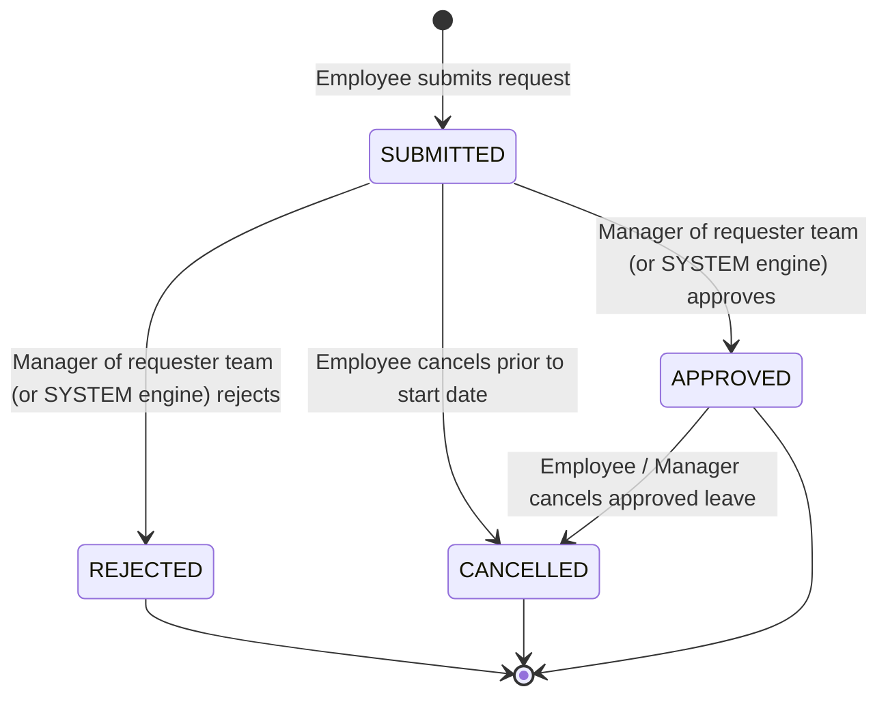
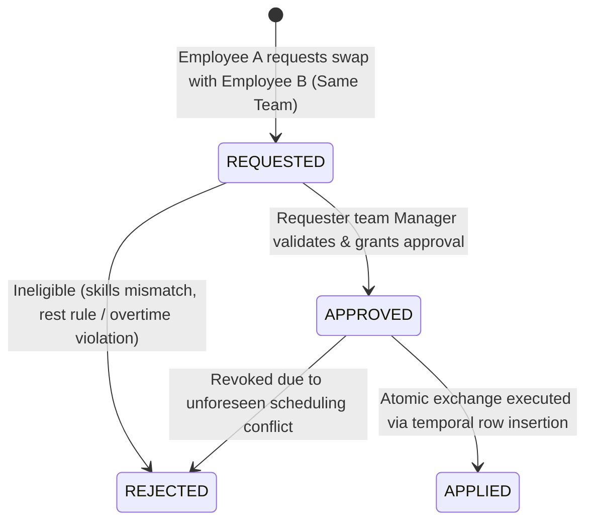

# Workforce Scheduling Synthetic Data Generator: Entity-Relationship Diagram

This document illustrates the data architecture, entity relationships, cardinalities, effective date scopes, and lifecycle state machines for the workforce scheduling domain, including source operational tables and downstream derived analytics tables.

---

## 1. Complete Entity-Relationship Diagram (Mermaid)

```mermaid
erDiagram
    TEAM ||--o{ EMPLOYEE : "employs (1:N)"
    TEAM ||--o{ COVERAGE_REQUIREMENT : "mandates (1:N)"
    TEAM ||--o{ SHIFT_ASSIGNMENT : "fulfills (1:N)"

    SKILL ||--o{ EMPLOYEE_SKILL : "certified_in (1:N)"
    SKILL ||--o{ COVERAGE_REQUIREMENT : "demanded_by (1:N)"

    EMPLOYEE ||--o{ EMPLOYEE_SKILL : "possesses (1:N)"
    EMPLOYEE ||--o{ SHIFT_ASSIGNMENT : "scheduled_for (1:N)"
    EMPLOYEE ||--o{ LEAVE_REQUEST : "requests (1:N)"
    EMPLOYEE ||--o{ ATTENDANCE_EVENT : "records (1:N)"
    EMPLOYEE ||--o{ SWAP_REQUEST : "initiates (1:N)"
    EMPLOYEE ||--o{ SWAP_REQUEST : "targets (1:N)"
    EMPLOYEE ||--o{ SWAP_REQUEST : "approves_as_manager (1:N)"
    EMPLOYEE ||--o{ LEAVE_REQUEST_EVENT : "acts_on (1:N)"
    EMPLOYEE ||--o{ SWAP_REQUEST_EVENT : "acts_on (1:N)"
    EMPLOYEE ||--o{ WEEKLY_HOURS_SUMMARY : "summarizes (1:N)"

    SHIFT_TEMPLATE ||--o{ COVERAGE_REQUIREMENT : "specifies (1:N)"
    SHIFT_TEMPLATE ||--o{ SHIFT_ASSIGNMENT : "instantiates (1:N)"

    COVERAGE_REQUIREMENT ||--|| COVERAGE_GAP : "benchmarks (1:1)"

    SHIFT_ASSIGNMENT ||--o{ ATTENDANCE_EVENT : "tracks_punches_if_active (1:N)"
    SHIFT_ASSIGNMENT ||--o{ SWAP_REQUEST : "requestor_shift (1:N)"
    SHIFT_ASSIGNMENT ||--o{ SWAP_REQUEST : "target_shift (1:N)"
    SHIFT_ASSIGNMENT ||--o{ SHIFT_ASSIGNMENT : "replaces_history (1:N)"

    LEAVE_REQUEST ||--|{ LEAVE_REQUEST_EVENT : "has_history (1:N)"
    SWAP_REQUEST ||--|{ SWAP_REQUEST_EVENT : "has_history (1:N)"

    HOLIDAY_CALENDAR {
        string holiday_id PK "HOL-2026-001"
        date calendar_date "2026-01-01"
        string name "New Year's Day"
        string jurisdiction "FEDERAL"
        boolean is_statutory "true"
    }

    TEAM {
        string team_id PK "TEAM-001"
        string name "Emergency Triage Team 001"
        string department "Clinical Operations"
        string timezone "UTC"
        boolean is_active "true"
    }

    SKILL {
        string skill_id PK "SKL-TRIAGE"
        string code "TRIAGE"
        string name "Patient Triage & Assessment"
        string category "Clinical"
    }

    EMPLOYEE {
        string employee_id PK "EMP-000001"
        string team_id FK "TEAM-001"
        string first_name "Jane"
        string last_name "Doe"
        string email "jane.doe@example.com"
        string role "STAFF"
        decimal weekly_contract_hours "40.0"
        decimal fte "1.00"
        date hire_date "2023-04-15"
        date termination_date "null"
        boolean is_active "true"
    }

    EMPLOYEE_SKILL {
        string employee_skill_id PK "ESK-000001"
        string employee_id FK "EMP-000001"
        string skill_id FK "SKL-TRIAGE"
        integer proficiency_level "4"
        date certified_date "2023-05-01"
        date expiry_date "2027-05-01"
        boolean is_primary "true"
    }

    SHIFT_TEMPLATE {
        string shift_template_id PK "SFT-A"
        string template_code "A"
        string name "Morning Shift"
        time start_time "06:00:00"
        time end_time "14:00:00"
        decimal duration_hours "8.0"
        integer unpaid_break_minutes "30"
        boolean is_overnight "false"
    }

    COVERAGE_REQUIREMENT {
        string coverage_id PK "COV-2026-000001"
        date effective_date "2026-01-01"
        string team_id FK "TEAM-001"
        string shift_template_id FK "SFT-A"
        string skill_id FK "SKL-TRIAGE"
        integer min_headcount "1"
        integer target_headcount "2"
    }

    SHIFT_ASSIGNMENT {
        string assignment_id PK "ASN-2026-000001"
        string shift_instance_id "SHIFT-2026-01-01-TEAM001-A"
        string employee_id FK "EMP-000001"
        string team_id FK "TEAM-001"
        string shift_template_id FK "SFT-A"
        date shift_date "2026-01-01"
        timestamp scheduled_start "2026-01-01T06:00:00Z"
        timestamp scheduled_end "2026-01-01T14:00:00Z"
        decimal duration_hours "8.0"
        string assigned_role "STAFF"
        string assignment_status "ACTIVE"
        timestamp effective_from "2025-12-28T00:00:00Z"
        timestamp effective_to "null"
        string swap_request_id FK "null"
        string replaces_assignment_id FK "null"
    }

    LEAVE_REQUEST {
        string leave_request_id PK "LVE-2026-000001"
        string employee_id FK "EMP-000001"
        string leave_type "ANNUAL"
        date start_date "2026-01-15"
        date end_date "2026-01-17"
        decimal requested_hours "24.0"
        string current_status "APPROVED"
        timestamp submitted_at "2026-01-02T09:30:00Z"
        timestamp decided_at "2026-01-02T11:15:00Z"
        string decision_reason "Approved: Sufficient coverage"
    }

    LEAVE_REQUEST_EVENT {
        string leave_event_id PK "LVE-EVT-2026-000001"
        string leave_request_id FK "LVE-2026-000001"
        string from_status "SUBMITTED"
        string to_status "APPROVED"
        timestamp event_timestamp "2026-01-02T11:15:00Z"
        string actor_type "EMPLOYEE"
        string actor_id FK "EMP-000020"
        string reason "Coverage verified by manager"
    }

    SWAP_REQUEST {
        string swap_request_id PK "SWP-2026-000001"
        string requestor_employee_id FK "EMP-000001"
        string requestor_assignment_id FK "ASN-2026-000001"
        string target_employee_id FK "EMP-000005"
        string target_assignment_id FK "ASN-2026-000014"
        string current_status "APPLIED"
        string manager_employee_id FK "EMP-000020"
        timestamp requested_at "2026-01-08T14:20:00Z"
        timestamp decided_at "2026-01-08T16:00:00Z"
        timestamp applied_at "2026-01-08T16:01:00Z"
        string rejection_reason "null"
    }

    SWAP_REQUEST_EVENT {
        string swap_event_id PK "SWP-EVT-2026-000001"
        string swap_request_id FK "SWP-2026-000001"
        string from_status "APPROVED"
        string to_status "APPLIED"
        timestamp event_timestamp "2026-01-08T16:01:00Z"
        string actor_type "SYSTEM"
        string actor_id "null"
        string notes "Non-destructive swap executed by SYSTEM engine"
    }

    ATTENDANCE_EVENT {
        string attendance_event_id PK "ATT-EMP-000001-20260101T055800Z"
        string employee_id FK "EMP-000001"
        string assignment_id FK "ASN-2026-000001"
        string event_type "CLOCK_IN"
        timestamp event_timestamp "2026-01-01T05:58:00Z"
        string source "BIOMETRIC"
        integer variance_minutes "-2"
        boolean is_exception "false"
        string exception_type "null"
    }

    COVERAGE_GAP {
        string gap_id PK "GAP-2026-000001"
        string coverage_id FK "COV-2026-000001"
        date effective_date "2026-01-01"
        string team_id "TEAM-001"
        string shift_template_id "SFT-A"
        string skill_id "SKL-TRIAGE"
        integer required_headcount "1"
        integer scheduled_headcount "2"
        integer gap_headcount "0"
        boolean is_critical "false"
        timestamp computed_at "2026-01-01T23:59:59Z"
    }

    WEEKLY_HOURS_SUMMARY {
        string summary_id PK "WHS-EMP-000001-2026W01"
        string employee_id FK "EMP-000001"
        integer iso_year "2026"
        integer iso_week "1"
        boolean is_partial_week "true"
        decimal contract_hours "40.0"
        decimal scheduled_hours "32.0"
        decimal regular_hours "32.0"
        decimal overtime_hours "0.0"
        boolean exceeds_overtime_cap "false"
        timestamp computed_at "2026-01-04T23:59:59Z"
    }
```

---

## 2. Cardinality Analysis & Relationship Specifications

| Parent Entity | Child Entity | Relationship Cardinality | Nullability / Participation | Foreign Key in Child | Purpose & Semantics |
| :--- | :--- | :--- | :--- | :--- | :--- |
| **Team** | **Employee** | `1 : N` | Mandatory parent, optional child | `team_id` | An employee belongs to exactly one operational team (100 teams total). |
| **Team** | **CoverageRequirement** | `1 : N` | Mandatory parent, optional child | `team_id` | Teams declare daily minimum staffing headcounts per shift and skill. |
| **Team** | **ShiftAssignment** | `1 : N` | Mandatory parent, optional child | `team_id` | Assignments fulfill team schedule commitments. |
| **Skill** | **EmployeeSkill** | `1 : N` | Mandatory parent, optional child | `skill_id` | Resolves `N:M` between Employee and Skill. |
| **Skill** | **CoverageRequirement** | `1 : N` | Mandatory parent, optional child | `skill_id` | Coverage demands specific certified competencies. |
| **HolidayCalendar** | *(Temporal Join)* | `N/A` | Reference calendar table | *Derived date join (`calendar_date == date`)* | No physical FK. Adjusts coverage targets, flags overtime/premium, and exempts leave hours. |
| **Employee** | **EmployeeSkill** | `1 : N` | Mandatory parent, optional child | `employee_id` | Tracks skill certifications held by an employee (1 to 3 per employee). |
| **Employee** | **ShiftAssignment** | `1 : N` | Mandatory parent, optional child | `employee_id` | Scheduled work slots allocated to non-manager employees. |
| **Employee** | **LeaveRequest** | `1 : N` | Mandatory parent, optional child | `employee_id` | Leave submitted by an employee (target 5,000 total). |
| **Employee** | **AttendanceEvent** | `1 : N` | Mandatory parent, optional child | `employee_id` | Real-time physical timeclock punches. |
| **Employee** | **WeeklyHoursSummary** | `1 : N` | Mandatory parent, optional child | `employee_id` | Downstream roll-up of weekly hours and overtime compliance. |
| **Employee (Mgr)**| **LeaveRequestEvent** | `0..1 : N` | Optional parent, optional child | `actor_id` | Approver must be `role == 'MANAGER'` and in requester's team (`NULL` for `SYSTEM`). |
| **Employee (Mgr)**| **SwapRequest** | `0..1 : N` | Optional parent, optional child | `manager_employee_id`| Designated manager of requester's team approving swap (`role == 'MANAGER'`). |
| **ShiftTemplate**| **CoverageRequirement**| `1 : N` | Mandatory parent, optional child | `shift_template_id` | Coverage is dimensioned per shift template (A/B/C). |
| **ShiftTemplate**| **ShiftAssignment** | `1 : N` | Mandatory parent, optional child | `shift_template_id` | Standard duration and timings for scheduled shift. |
| **ShiftAssignment**| **AttendanceEvent**| `1 : N` | Optional parent, optional child | `assignment_id` | Links punches (in, out) **strictly to ACTIVE assignments**. |
| **ShiftAssignment**| **SwapRequest** | `1 : N` | Optional parent, optional child | `requestor_assignment_id`| Shift slot being offered for exchange. |
| **ShiftAssignment**| **SwapRequest** | `1 : N` | Optional parent, optional child | `target_assignment_id` | Shift slot being requested in return. |
| **ShiftAssignment**| **ShiftAssignment** | `1 : N` | Optional parent, optional child | `replaces_assignment_id`| Temporal swap history: links new active row to replaced row. |
| **CoverageRequirement**| **CoverageGap** | `1 : 1` | Mandatory parent, mandatory child | `coverage_id` | **Direct foreign key**: Evaluates required vs scheduled active headcount. |
| **LeaveRequest** | **LeaveRequestEvent**| `1 : N` | Mandatory parent, mandatory child (>=1)| `leave_request_id` | Immutable audit log of leave state transitions. |
| **SwapRequest** | **SwapRequestEvent** | `1 : N` | Mandatory parent, mandatory child (>=1)| `swap_request_id` | Immutable audit log of swap state transitions. |

> [!NOTE]
> **No Foreign Keys from Mutable Operational ShiftAssignment to Derived Tables**:
> `ShiftAssignment` does **not** maintain physical foreign key relationships to `CoverageGap` or `WeeklyHoursSummary`. Downstream analytics scripts aggregate active `ShiftAssignment` records dynamically during pipeline execution.

---

## 3. Deliberate ID Formats & Global Uniqueness

1. **Shift Instance Global Uniqueness Across 100 Teams**:
   - `SHIFT-YYYY-MM-DD-TEAM{team_id:03d}-{template_code}` (e.g., `SHIFT-2026-01-01-TEAM001-A`).
   - Deliberate architectural extension of the brief's `SHIFT-YYYY-MM-DD-X`: resolving the team token avoids identical ID collisions across 100 teams operating on the same date and shift code ($100 \times 90 \times 3 = 27,000$ unique instances).
2. **Scheduling Horizon**:
   - `CoverageRequirement.effective_date`: Valid strictly between `2026-01-01` and `2026-03-31` (Q1 2026, 90 days).
   - `ShiftAssignment.shift_date`: Scheduled dates fall within the active planning horizon.
3. **Temporal Bitemporal Windows on ShiftAssignment**:
   - `effective_from` / `effective_to`: Every assignment record stores its validity lifespan.
   - When active: `effective_from = publication_time`, `effective_to = NULL`.
   - When swapped out: `effective_to = swap_applied_time`, and a replacement row is created with `effective_from = swap_applied_time`.
   - Original rows are **never deleted or overwritten in place**.

---

## 4. Lifecycle State Machines & History Invariants

### 4.1 Leave Request Lifecycle & Manager Authorization Rules

> [!IMPORTANT]
> **Actor Type & Manager Authorization Rules**:
> 1. `LeaveRequest.current_status` **MUST EQUAL** the latest `LeaveRequestEvent.to_status`.
> 2. `actor_type` is either `EMPLOYEE` or `SYSTEM`.
> 3. If `actor_type == 'EMPLOYEE'`, `actor_id` **must be a valid employee with `role == 'MANAGER'` belonging to the requester's team (`team_id == requester.team_id`)**.
> 4. If `actor_type == 'SYSTEM'`, `actor_id` is `NULL`.

---

### 4.2 Shift Swap Lifecycle & Temporal Row Preservation

> [!IMPORTANT]
> **Swap Rules & Versioning Invariants**:
> 1. **Same Team**: Requestor and target must belong to the **same operational team** (`requestor.team_id == target.team_id`).
> 2. **Skill Match**: Requestor must possess required skills for target's shift, and vice versa.
> 3. **Fatigue Checks**: Post-swap schedules must satisfy 11-hour rest and 48-hour weekly caps.
> 4. **Manager Approval**: `manager_employee_id` must have `role == 'MANAGER'` and match the team.
> 5. **Non-Destructive Versioning**:
>    - $A_1.\text{assignment\_status} \leftarrow \text{'SWAPPED\_OUT'}$; $A_1.\text{effective\_to} \leftarrow \text{applied\_at}$.
>    - $A_2.\text{assignment\_status} \leftarrow \text{'SWAPPED\_OUT'}$; $A_2.\text{effective\_to} \leftarrow \text{applied\_at}$.
>    - Old rows are **never deleted or reassigned** (`employee_id` remains original).
>    - New replacement rows are inserted with `assignment_status = 'ACTIVE'`, `effective_from = applied_at`, `effective_to = NULL`, referencing `swap_request_id` and `replaces_assignment_id`.
